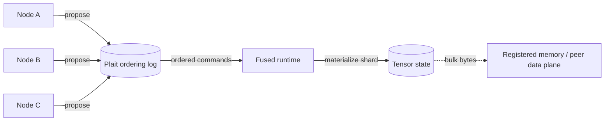

<p align="center">
  
</p>

<h1 align="center">Plait</h1>

<p align="center">
  <strong>A rankless, ordering-driven tensor fabric.</strong>
</p>

<p align="center">
  Rust 2024 · leaderless ordering · no rank 0 · TP/PP/EP/DP/CP/SP · heterogeneous accelerators · GPU peer-memory collectives
</p>

Plait is a research runtime for distributed tensor work. It replaces the fixed
process group and rank-zero driver of a traditional collective with a
leaderless ordered log. Every node has a stable `NodeId`, every contribution is
an ordered command, and every replica applies the same state transition.

This is not a production training system. The control plane, fused runtime,
GPU peer-memory collectives, heterogeneous planner, and formal models are
implemented and tested. Cross-host GPUDirect RDMA, durable state, authentication,
and production-scale validation are not.

## Why this design

A conventional collective assumes a fixed communicator. Ranks are array
positions; membership changes require rebuilding the group and the communication
plan. Plait assumes churn. Nodes join and leave, GPUs differ in compute and link
class, and a single operator may have a different contributor set from the one
before it.



The log carries control metadata and small partials. Large tensors stay in
registered memory and move through peer pointers or one-sided descriptors.

## What is implemented

- **Leaderless ordering.** Any voter may propose. Fast-path dependency
  agreement, slow-path acceptance, ballot-based recovery, snapshots, and
  membership changes are implemented in `plait-consensus`.
- **Fused runtime.** `DeclareOp`, `Contribute`, and `Fuse` materialize tensor
  shards after all declared contributors have been applied. `Sum`, `Max`,
  `Gather`, `TopK`, and `OnlineSoftmax` are implemented.
- **SCC execution.** `ExecutionGraph` maintains an online SCC condensation.
  Independent components are ready in parallel; conflicting components stay
  together.
- **GPU peer-memory collectives.** Ring allreduce, broadcast, reduce,
  all-gather, reduce-scatter, and all-to-all use CUDA peer memory and
  device-resident flags in `plait-collective`. The device-ring allreduce is the
  default path.
- **Heterogeneous planning.** `HeterogeneousLayout` solves a max-min linear
  program over compute rate, effective bandwidth, and latency, then maps the
  result to contiguous row ranges.
- **Rejoin policy.** `RejoinCost` chooses between strict recovery, snapshot
  replay, and deterministic recomputation.
- **Formal models.** TLA+ covers ordering, epoch admission, and the path from
  quantized shard computation to asynchronous reduction and result delivery.

## Measured baseline

On one host with eight NVIDIA Blackwell GPUs, PCIe topology, no NVLink, Plait's
device-ring allreduce measured:

| Size | Plait | NCCL 2.30.4 |
|---:|---:|---:|
| 1 MiB | 11.0 GB/s | 4.82 GB/s |
| 16 MiB | 16.3 GB/s | 12.72 GB/s |
| 64 MiB | 15.7 GB/s | 13.60 GB/s |

The matrix path also matches NCCL's float allreduce checksum at `8x8x6` and
`64x64x64`. These numbers cover same-host allreduce only. They are not an
end-to-end training claim.

LL and LL128 protocol kernels exist but remain opt-in. On the PCIe test host,
their per-line synchronization is slower than the ring; PCIe defaults to ring
plus `Simple`.

## Heterogeneous 4+8 example

The planner models four NVIDIA Ampere ranks and eight NVIDIA Blackwell ranks:

```text
4 × NVIDIA Ampere     PCIe, compute 1.0, 25 Gbps
8 × NVIDIA Blackwell UB,   compute 4.0, 200 Gbps
```

Run:

```sh
cargo run -q -p plait-node -- hetero-plan
```

It reports fractional shares, integer row ranges, and the equal-split
comparison:

```text
local_share=0.111 remote_share=0.889
rows=64 local_rows=7 remote_rows=57
rows=64 equal_split_local=21 equal_split_remote=43
```

The eight faster ranks receive most of the work. Quorum membership remains one
vote per node; weights only change work assignment.

## Quick start

Install `just` and a Rust toolchain, then:

```sh
just test        # workspace tests
just demo        # three TCP nodes, fused sum
just dsa         # TP/CP sparse attention reference
just parallel    # EP MoE, DP optimizer, PP stage handoff
just devices     # discovered device profiles
just hetero      # capability-aware compute placement
just hetero-plan # 4+8 heterogeneous LP demo
cargo run -q -p plait-node -- hetero-plan --local-gflops 1394 --remote-gflops 4317
just matrix      # 12-replica matrix collective
just ipc         # two-process CUDA IPC allreduce
just tcp-twolevel-rust # Rust host-staged two-level TCP fallback
just gpu         # CUDA AXPY and CUTLASS SGEMM
just gpu-bench   # per-GPU CUTLASS SGEMM throughput
just rdma        # real ibverbs or an explicit skip
just ci          # fmt, lint, tests, demos
```

`just setup` clones CUTLASS into `target/cutlass` if needed. The CUDA build
selects the local architecture; no generated CUTLASS tree is committed.

## Commands and hardware

The GPU data plane requires peer-capable CUDA devices. Local NVIDIA Ampere machines
may refuse cross-GPU peer access; tests report the skip instead of hiding it.
The NVIDIA Blackwell host passes cross-GPU IPC.

The ibverbs backend compiles and links. The ordinary containers expose no
`/dev/infiniband`, no active verbs device, and no `CAP_NET_ADMIN`, so
`just gpu-rdma` and `just rdma` report explicit skips.

### TCP fallback

`crates/plait-collective/src/bin/tcp-twolevel.rs` is the Rust two-host
fallback. It reduces worker inputs into one host leader, exchanges the
aggregate over four TCP channels, publishes the result through shared memory,
and uses a ready barrier outside the timing loop. It is host-staged, not a
GPUDirect path.

Measured with 4 local NVIDIA Ampere ranks and 8 remote NVIDIA Blackwell ranks:

```text
1 MiB   0.081-0.083 GB/s  > NCCL 0.050
16 MiB  0.281-0.286 GB/s  > NCCL 0.273
errors=0
```

`crates/plait-nccl` provides a PyO3 NCCL-compatible communicator for vLLM.
The vLLM fork uses peer transport for TP when `VLLM_USE_PLAIT=1` is set.
Each worker exchanges endpoint metadata over Gloo and sends tensors directly
to its peers. [Peer transport and startup](docs/rankless-nccl.md)

Managed replacements can reuse complete prompt KV blocks across TP sizes
with the vLLM fork's `PlaitKvConnector` and `plait-node kv-store`.
The ingress can restore a greedy stream's emitted token checkpoint and
reuse pages from both the prompt and generated prefix.
[KV setup and scope](docs/rankless-nccl.md#reuse-prompt-kv-across-tp-layouts)

The control plane can activate a prepared replacement at final readiness
or promote it when the incumbent is revoked.
[Automatic rollout and standby](docs/rankless-nccl.md#commit-an-automatic-rollout-or-standby)
Resident execution nodes discover voters from seed addresses and start
their committed vLLM assignments using local engine profiles.
[Resident launches](docs/rankless-nccl.md#start-groups-from-resident-execution-nodes)
The planner can cap a hosted candidate's capacity using fresh TCP
samples, including traffic shared by multiple TP workers on one host.
[Measured host links](docs/rankless-nccl.md#replan-with-measured-host-links)

For the legacy rendezvous, `PLAIT_NCCL_SHM=1` enables the host-mapped local
path and `PLAIT_NCCL_KERNEL=1` enables the single-stream GPU allreduce path.
`plait_nccl.kernel_config(device, quantization)` returns a vLLM `KernelConfig`
using Humming on SM120 and Marlin/Cutlass on Ampere; the collective itself
stays bf16/fp16.
`plait_parallel::choose_codesign` picks the smallest fitting
`(quant format, TP group)`; eight SM120 cards therefore run 122B NVFP4 as four
TP2 replicas, while a 4B model runs as twelve TP1 replicas.
`plait_nccl.CapabilityRouter` routes local 9B-W4A16, remote 35B-FP8, and remote 122B-NVFP4 tiers.
The 122B tier requires native vLLM multiprocessing TP2; external-launcher TP
produced degenerate Qwen3.5 output even in BF16. FP8 communication is opt-in
(`plait_nccl.comm_quant.all_reduce_fp8`) and its accuracy/bandwidth gate
defaults off; it is only for cross-host TP.

Native TP startup (Qwen3.5 must not use `external_launcher`):

```bash
# four NVIDIA Ampere devices, one W4A16 TP1 replica per device
python scripts/serve-tiered.py --model /mnt/nas1/hf/Qwen3.5-9B-W4A16 \
  --replicas 4 --tp 1 --port-base 8000
# eight NVIDIA Blackwell devices, 122B-NVFP4, four independent native TP2 replicas
python scripts/serve-tiered.py --model /mnt/nas1/hf/Qwen3.5-122B-A10B-NVFP4 \
  --replicas 4 --tp 2 --port-base 8100 --max-model-len 1024
```

Run it with:

```bash
just tcp-twolevel-rust
```

## Formal verification

An admitted operation carries an epoch and a fixed set of shards. A worker may
finish locally after revocation. Before publishing a shard, the worker waits
for a matching device event, copies the output, and checks its grant in the
control plane. Revocation can execute between that check and the local store.
Shards can arrive out of order and are folded in shard order. The caller can
release the result after the matching completion has executed in the control plane.

| TLA+ module | Properties checked with TLC |
| --- | --- |
| [Kernel primitives](specs/PlaitKernelPrimitives.tla) | Signed decoding, packed coordinate mapping, and exact integer dot products with accumulator bounds. |
| [W4A4](specs/PlaitW4A4.tla) and [W4A8 / W4A16](specs/PlaitW4Operators.tla) | INT32 zero-point correction and tail reads for W4A4, byte-wise subtraction for W4A8, and packed indexing and dequantization before rounding for W4A16. |
| [Asynchronous reduction](specs/PlaitAsyncReduction.tla) | W4A4 device completion, stale-event rejection, and deterministic folding. An independent operation completes even while a producer or pull in another operation stalls. |
| [Ordered publication](specs/PlaitOrderedPublication.tla) | Completion and revocation in the agreed command order, receipt identity on retry, and recovery from a replica's durable command prefix. |
| [Peer collectives](specs/PlaitPeerCollective.tla) | Round pairing, replicated and sharded reduction, and completion of an independent communicator when a participant in another group is lost. |
| [Hosted rollout and failover](specs/PlaitHostLaunch.tla) | Full readiness before activation, ordered standby promotion on incumbent revocation, and exclusion of groups affected by the same host loss. |
| [Hosted assignment](specs/PlaitHostedAssignment.tla) | An observed assignment requires an ordered claim before launch. The local lock remains held through supervisor loss until the launcher exits. |
| [KFD device release](specs/PlaitKfdRelease.tla) | A complete report for the captured device checks its queues and VRAM. Activity on another device leaves release enabled. |
| [Hosted link evidence](specs/PlaitHostedLinkEvidence.tla) | A measured placement requires fresh evidence in both directions with probe sessions matching the planner's directory snapshot. |
| [Hosted pool reservations](specs/PlaitHostedPool.tla) | A placement is checked against current inventory when prepared. Competing placements cannot reserve the same devices or API ports, including while a revoked group awaits retirement. |
| [Hosted P/D publication](specs/PlaitHostedPd.tla) | Both roles cut over in one publication after their participants report readiness. Candidate failure or a changed directory revision prevents a stale cutover. |
| [Hosted P/D budgeting](specs/PlaitHostedPdBudget.tla) | Equal path shares consume the same Prefill and directional port budgets. The model checks combined TP and KV demand on shared ports. |
| [Hosted P/D scaling](specs/PlaitHostedPdScale.tla) | A proposed change uses repeated observations from the current ingress session and directory revision. Publication starts a new cooldown. |
| [Hosted P/D role transition](specs/PlaitHostedPdTransition.tla) | The replacement route becomes live before the old group retires. The target acquires the retired device only after release and becomes visible only after readiness. |
| [Hosted P/D reconfiguration](specs/PlaitHostedPdReconfigure.tla) | A bridge preserves the incumbent rate. The projected gain pays for the transition. Commit checks the directory and declared release capability. |
| [Hosted P/D recovery](specs/PlaitHostedPdRecovery.tla) | A spare can restore a failed slot without ingress traffic. Cutover preserves healthy epochs, checks readiness and directory revision, and leaves old grants subject to release proof. |
| [Serving ingress](specs/PlaitServingIngress.tla) | One admission per ordinary forwarded request, monotonic route refresh, and output pinned to the admitted epoch while the old gate drains. |
| [Completion replay and KV resume](specs/PlaitCompletionReplay.tla) | Visible positions are preserved. Each KV resume sends the latest checkpoint and requires a matching acknowledgment and prefix before publishing a suffix. |
| [KV publication](specs/PlaitKvPublication.tla) | All heads must come from one write attempt before a page becomes readable. A consumer reads its requested head range, and a complete page stays immutable. |
| [Prefill to Decode handoff](specs/PlaitKvHandoff.tla) | The receipt matches the request context. Decode emits output after loading the required pages, including when the shared store can reset between admission and load. |
| [P/D stream replay](specs/PlaitPdStreamReplay.tla) | A failed Decode version is excluded. Each attempt releases its own handoff, and suffix output follows a checked prefix. |

TLC 2.19 passes all 44 configurations. The ordered publication configuration
explores 70,968 distinct states. Run the suite with `tlc` on your `PATH`.

```sh
./scripts/check-tla.sh
```

TLAPS discharged all 128 obligations. They establish W4A4 zero-point
correction for any finite group, packed-read bounds under the load guards, and
the matching-event and copy requirements for device publication.
[Proof module](specs/PlaitContractsProof.tla)

Run the proofs with `tlapm` on your `PATH`. The run uses the 1.6.0 pre-release
at commit `e4d66f4`. [TLAPS release](https://github.com/tlaplus/tlapm/releases/tag/1.6.0-pre)

```sh
(
  cache=$(mktemp -d)
  trap 'rm -rf "$cache"' EXIT
  tlapm --strict --threads 2 --cache-dir "$cache" specs/PlaitContractsProof.tla
)
```

The device model assumes stream ordering and output visibility after a
successful wait and copy. The ordered publication model assumes a common
order for commands that affect the same group. Each finite configuration
defines the inputs, faults, and fairness explored by TLC.

## Repository layout

| Crate | Responsibility |
| --- | --- |
| `plait-core` | identities, tensors, commands, conflict keys, membership, quorum policy |
| `plait-consensus` | leaderless ordering, ballots, recovery, SCC execution, snapshots |
| `plait-fabric` | fused runtime and replicated state transitions |
| `plait-collective` | CUDA peer-memory collectives, IPC/VMM, topology, protocols |
| `plait-parallel` | TP/PP/EP/DP/CP/SP planning, DSA/MoE/DP/PP runners, heterogeneous LP, rejoin |
| `plait-mem` | aligned buffers, pooling, registered regions, RDMA contract |
| `plait-rdma` | real libibverbs RC QP, one-sided read/write, completion polling |
| `plait-net` | framed TCP control transport |
| `plait-device` | device discovery and capability scheduling |
| `plait-gpu` | CUDA AXPY and CUTLASS SGEMM execution |
| `plait-node` | cluster process, client, benchmarks, demos |
| `plait-nccl` | PyO3 NCCL-compatible communicator for PyTorch/vLLM |

Design documents:

- [docs/design/plait.md](docs/design/plait.md) — design of record
- [docs/design/plait-requirements.md](docs/design/plait-requirements.md) — requirements
- [docs/design/asymmetric.md](docs/design/asymmetric.md) — heterogeneous row scheduling
- [docs/architecture.md](docs/architecture.md) — protocol and data flow
- [docs/parallelism.md](docs/parallelism.md) — parallelism-axis mapping
- [docs/rdma.md](docs/rdma.md) — verbs backend and setup
- [docs/goals/tcp-parity.md](docs/goals/tcp-parity.md) — TCP/NCCL acceptance goal
- [docs/nccl-python.md](docs/nccl-python.md) — vLLM/Python NCCL compatibility backend
- [docs/rankless-nccl.md](docs/rankless-nccl.md) — rankless groups and vendor backends
- [specs/](specs/) — TLA+ models and TLC configurations

## Limitations

- No authentication or encryption. The transport trusts the network.
- The local replica journal recovers ordered control state. Device buffers
  and in-flight tensor transfers must be recreated after process loss.
- No verified cross-host GPU-buffer collective outside the host-staged `plait-nccl` TCP path.
- Native kernel availability depends on the backend, architecture, shape,
  and activation format. Check the adapter's advertised capability before
  choosing a placement.
- LL/LL128 remain opt-in and are slower on the tested PCIe host.
- Vendor instruction semantics, floating-point rounding, and refinement from
  the Rust runtime and device code to these specifications remain open.

## License

See [LICENSE](LICENSE).
