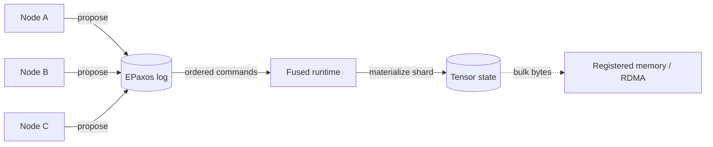

<p align="center">
  
</p>

<h1 align="center">Plait</h1>

<p align="center">
  <strong>A rankless, consensus-fused tensor fabric.</strong>
</p>

<p align="center">
  Rust 2024 · EPaxos-style replication · no rank 0 · TP/PP/EP/DP/CP/SP · registered-memory data plane
</p>

Plait is an experimental runtime in which **communication is the replicated log**.
Instead of building a collective around a fixed process group and a rank-zero
driver, every process proposes tensor work into a leaderless consensus log. The
same ordered commands that coordinate a collective also carry the fused
operator's state transition. There is no special node, no global barrier, and
no array position that has to mean "leader".

This repository is a from-scratch Rust rewrite. The previous C++/CMake
foundation has been removed; the workspace now contains the protocol, fused
runtime, TCP transport, registered-memory data plane, parallelism planner, and a
runnable distributed DSA reference operator.

> **Status:** research prototype, not a production training system. Correctness
> and the end-to-end mechanism are exercised by tests; security, persistence,
> real RNIC binding, and production-scale performance are explicit remaining
> work.

## The core idea



A command such as "contribute a local partial to operator `op`" is replicated.
When the last declared contributor has executed, every replica combines the
partials locally. The result is materialized without a separate all-reduce
phase. Conflicting commands are ordered by EPaxos dependencies; independent
operators proceed concurrently.

The important properties are:

- **Identity, not rank.** `NodeId` is a stable 128-bit identity. It is never an
  array index and never changes when membership changes.
- **Leaderless steady state.** Any voter may propose. Any voter may recover a
  stalled instance by raising a ballot.
- **Membership is replicated state.** A join is a staged learner plus a
  unanimous promotion; a leave is a staged removal plus a unanimous commit.
  There is no bootstrap controller with permanent authority.
- **Communication is computation.** A contribution moves inside the replicated
  command and is consumed by the same state-machine transition on every
  replica. There is no separate "communicate then compute" collective.
- **Bulk data stays out of the log.** Small indices and partials travel inline;
  large tensors live in registered regions and move through one-sided
  descriptor operations.

EPaxos is used here as a **design point**, not a claim of a byte-for-byte paper
implementation. The implementation includes fast-path dependency agreement,
Paxos slow-path acceptance, dependency-cycle execution, ballot-based recovery,
and snapshot catch-up. The deliberate deviations are documented under
[Guarantees and limits](#guarantees-and-limits).

## Parallelism alignment

Every parallelism axis is represented as a **participant group plus conflict
keys**, not as a collective that every process must enter. The planner lives in
`crates/plait-parallel/src/plan.rs`; the table is the contract between the
planner and the consensus/runtime layer.

| Axis | Work that is sharded | Plait mechanism | Conflict domain | Transfer |
| --- | --- | --- | --- | --- |
| **TP** tensor parallel | Attention heads / projection columns | Fused partial-sum output projection; per-head gathers | `tp:<cp>:output`, `seq:<tp>:<head>:*` | Registered for Q/K/V, inline for indices |
| **PP** pipeline parallel | Layers into stages | Microbatch handoff command; dependency chain per activation | `pp:<stage>:<microbatch>` | Registered descriptor |
| **EP** expert parallel | Tokens across experts | Sparse dispatch; per-expert compute; token combine as fused sum | `ep:<expert>:dispatch|combine` | Registered dispatch, inline combine |
| **DP** data parallel | Replicated model replicas | Per-parameter-shard gradient accumulation; no global optimizer barrier | `dp:<replica>:gradient:<shard>` | Registered |
| **CP** context parallel | Sequence into KV shards | Local top-k candidates → global top-k; online-softmax partials | `ctx:<tp>:<head>:<query>:*` | Inline scores/partials; RDMA for Q |
| **SP** sequence parallel | Sequence shards within TP | Sequence gather for Q/Q-index; aliases the CP physical group in the reference runner | `seq:<tp>:<head>:*` | Inline index, registered activation |

The planner emits concrete fused operations with contributor sets and op ids:

- `FusedSum` replaces all-reduce / reduce-scatter for DP, TP output, and EP
  combine.
- `Gather` replaces all-gather for sequence/Q-index data.
- `TopK { k }` merges local sparse-attention candidate lists; no full score
  matrix needs to be all-gathered.
- `OnlineSoftmax` combines context-parallel partial softmax states
  `(max, sum, accumulator)` without a second global reduction.
- `PipelineHandoff` and `Dispatch` are registered-memory transfers coordinated
  by a small command; the bytes never enter the log.

`cargo test -p plait-parallel` checks that all six axes have an EPaxos mapping
and that participant groups match the topology.

## Distributed DSA

`plait-parallel` contains a runnable **DeepSeek-style sparse attention (DSA)**
reference layer:

1. Q-index vectors are gathered across the CP/SP group through a fused
   `Gather` command.
2. Q is pulled through the registered-memory data plane (the loopback backend
   in this repository) rather than placed in the log.
3. Each CP shard computes local indexer scores for every query and contributes
   its local top-k candidates. A fused `TopK` command merges them into the
   global sparse key set.
4. Each CP shard computes a partial softmax state over its local selected K/V
   and contributes `(max, sum, accumulator)`. A fused `OnlineSoftmax` command
   produces the exact attention output.
5. TP shards compute partial output projections; a fused `Sum` completes the
   projection.

The reference runner is checked against a single-node implementation for both
context-parallel and tensor-parallel topologies:

```text
$ cargo run -q -p plait-node -- dsa
plait dsa: context-parallel output matches reference (max error 1.110e-16, 110 instances)
plait dsa: tensor-parallel output matches reference (max error 1.110e-16, 55 instances)
```

## Registered memory and RDMA

`plait-mem` provides the data-plane contract:

- page-aligned `AlignedBuffer` allocations;
- a size-class `BufferPool` that returns buffers on drop;
- `RegionDescriptor { node, region, offset, len, rkey, kind }`, the only thing a
  consensus command needs to reference bulk data;
- `RdmaPlane` with one-sided `read`/`write`;
- `LoopbackRdma`, a validated in-process implementation used by tests and the
  DSA runner.

`plait-net` uses length-prefixed framed TCP with reusable send/receive buffers
as the portable fallback. A real `ibverbs` backend plugs into `RdmaPlane`; the
development container has no RNIC, so no hardware-specific FFI is claimed here.
The important separation is already enforced: large tensors do not go through
consensus, and consensus never needs to know a NIC queue-pair layout.

## Quick start

```sh
cargo test --workspace
cargo run -p plait-node -- demo   # three real TCP nodes, fused sum, all peers query
cargo run -p plait-node -- dsa    # distributed DSA vs single-node reference
```

Run a cluster process:

```sh
# Generate stable identities once, keep them in your deployment config.
cargo run -q -p plait-node -- id

# Every bootstrap node receives the same peer manifest.
cargo run -p plait-node -- run \
  --id <hex> --listen 127.0.0.1:7001 \
  --peer <hex-a>@127.0.0.1:7001 \
  --peer <hex-b>@127.0.0.1:7002 \
  --peer <hex-c>@127.0.0.1:7003
```

A new process joins through any member; no rank-zero address is needed:

```sh
cargo run -p plait-node -- run \
  --id <new-hex> --listen 127.0.0.1:7004 \
  --join <hex-b>@127.0.0.1:7002
```

The joining node receives a snapshot, replays the executed prefix, acknowledges
the unanimous promotion, and then proposes like every other voter.

## Workspace

| Crate | Responsibility |
| --- | --- |
| `plait-core` | identities, tensors/placement, commands, conflict keys, membership/quorums |
| `plait-consensus` | leaderless EPaxos instances, ballots, recovery, SCC execution, snapshots |
| `plait-fabric` | fused runtime (`Sum`, `Max`, `Gather`, `TopK`, `OnlineSoftmax`) and events |
| `plait-mem` | aligned buffers, pooling, registered regions, RDMA contract, loopback plane |
| `plait-net` | framed TCP transport and the wire protocol |
| `plait-parallel` | TP/PP/EP/DP/CP/SP planner, in-process consensus cluster, distributed DSA |
| `plait-node` | real cluster process, join/snapshot flow, client, demos |

See [docs/architecture.md](docs/architecture.md) for the protocol and execution
details, and [docs/parallelism.md](docs/parallelism.md) for the axis mapping.

## Guarantees and limits

What is implemented and tested:

- fast-path agreement and slow-path acceptance for conflicting proposals;
- concurrent conflicting proposals from every node converging to the same state;
- recovery by any replica after the original proposer stops;
- dependency cycles executed through strongly connected components;
- membership add/remove with snapshots, staged learners, and unanimous
  promotion/removal;
- three-node real-TCP submission, fusion, and query;
- dynamic join over TCP, followed by a proposal from the new voter;
- CP and TP distributed DSA matching the single-node reference within `1e-16`;
- pooled/aligned memory, registered descriptors, and one-sided loopback
  transfers bounds-checked.

Deliberate limits of this prototype:

- **No authentication or encryption.** The transport trusts the network. A
  production deployment must authenticate `NodeId` and authorize membership.
- **No durable state.** Node restart with the same identity is not handled;
  instances and counters live in memory. A voter that misses a membership
  change while partitioned must be restarted/rejoined; automatic snapshot
  catch-up for an existing stale voter is future work.
- **Membership is conservative.** Staging and committing a membership change
  require every relevant voter. Steady-state consensus still tolerates
  `floor((N-1)/2)` failures, but a membership change stalls if any voter is
  down. A joint-consensus configuration for online reconfiguration is future
  work.
- **Small payloads are inline.** The DSA reference uses descriptors for bulk Q
  and inline candidates/partials. The generic `Contribute` command still has an
  inline `Vec<f64>` variant; a fully descriptor-based tensor command and
  `ibverbs` backend are the next data-plane step.
- **One replication group.** Every command is replicated by the configured
  voters. Per-domain consensus groups (for very large TP/EP deployments) are a
  planner/runtime extension, not yet implemented.
- **No persistence or checkpointing**, no backpressure, no production
  scheduler, and no Torch-compatible frontend.

## Roadmap

- [x] Rust workspace and removal of the C++ foundation
- [x] Identity-based membership and leaderless proposal/recovery
- [x] Fused `Sum`/`Max`/`Gather`/`TopK`/`OnlineSoftmax` runtime
- [x] Real-TCP cluster, snapshot join, and new-voter proposal
- [x] TP/PP/EP/DP/CP/SP operation planner
- [x] Context- and tensor-parallel DSA reference execution
- [x] Registered-memory descriptors, pooling, and loopback data plane
- [ ] Real `ibverbs`/GPUDirect RDMA backend
- [ ] Descriptor-only bulk contribution commands and completion queues
- [ ] Per-domain consensus groups and hierarchical membership
- [ ] Durable snapshots, identity persistence, and authenticated transport
- [ ] MoE EP execution and pipeline-parallel scheduling on the planner
- [ ] Larger-model DSA and attention benchmarks with RDMA traffic accounting

## Relationship to Ferrule

Ferrule can consume Plait rather than hide it. Ferrule decides what a model
should compute; Plait owns tensor identity, placement, consensus ordering,
fused communication, and the data plane. The boundary stays useful for
training, inference, simulation, and non-ML array workloads alike.

## License

MIT. See [LICENSE](LICENSE).