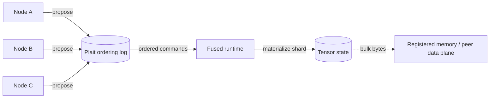

<p align="center">
  
</p>

<h1 align="center">Plait</h1>

<p align="center">
  <strong>A rankless, ordering-driven tensor fabric.</strong>
</p>

<p align="center">
  Rust 2024 · leaderless ordering · no rank 0 · TP/PP/EP/DP/CP/SP · heterogeneous accelerators · GPU peer-memory collectives
</p>

Plait is a research runtime for distributed tensor work. It replaces the fixed
process group and rank-zero driver of a traditional collective with a
leaderless ordered log. Every node has a stable `NodeId`, every contribution is
an ordered command, and every replica applies the same state transition.

This is not a production training system. The control plane, fused runtime,
GPU peer-memory collectives, heterogeneous planner, and formal models are
implemented and tested. Cross-host GPUDirect RDMA, durable state, authentication,
and production-scale validation are not.

## Why this design

A conventional collective assumes a fixed communicator. Ranks are array
positions; membership changes require rebuilding the group and the communication
plan. Plait assumes churn. Nodes join and leave, GPUs differ in compute and link
class, and a single operator may have a different contributor set from the one
before it.



The log carries control metadata and small partials. Large tensors stay in
registered memory and move through peer pointers or one-sided descriptors.

## What is implemented

- **Leaderless ordering.** Any voter may propose. Fast-path dependency
  agreement, slow-path acceptance, ballot-based recovery, snapshots, and
  membership changes are implemented in `plait-consensus`.
- **Fused runtime.** `DeclareOp`, `Contribute`, and `Fuse` materialize tensor
  shards after all declared contributors have been applied. `Sum`, `Max`,
  `Gather`, `TopK`, and `OnlineSoftmax` are implemented.
- **SCC execution.** `ExecutionGraph` maintains an online SCC condensation.
  Independent components are ready in parallel; conflicting components stay
  together.
- **GPU peer-memory collectives.** Ring allreduce, broadcast, reduce,
  all-gather, reduce-scatter, and all-to-all use CUDA peer memory and
  device-resident flags in `plait-collective`. The device-ring allreduce is the
  default path.
- **Heterogeneous planning.** `HeterogeneousLayout` solves a max-min linear
  program over compute rate, effective bandwidth, and latency, then maps the
  result to contiguous row ranges.
- **Rejoin policy.** `RejoinCost` chooses between strict recovery, snapshot
  replay, and deterministic recomputation.
- **Formal models.** Finite TLA+ models under `specs/` cover the scheduler,
  ordering safety, dependency stability, recovery liveness, and the unified
  compute/fusion/commit/execute design.

## Measured baseline

On one host with eight RTX PRO 5000 GPUs, PCIe topology, no NVLink, Plait's
device-ring allreduce measured:

| Size | Plait | NCCL 2.30.4 |
|---:|---:|---:|
| 1 MiB | 11.0 GB/s | 4.82 GB/s |
| 16 MiB | 16.3 GB/s | 12.72 GB/s |
| 64 MiB | 15.7 GB/s | 13.60 GB/s |

The matrix path also matches NCCL's float allreduce checksum at `8x8x6` and
`64x64x64`. These numbers cover same-host allreduce only. They are not an
end-to-end training claim.

LL and LL128 protocol kernels exist but remain opt-in. On the PCIe test host,
their per-line synchronization is slower than the ring; PCIe defaults to ring
plus `Simple`.

## Heterogeneous 4+8 example

The planner models four RTX 3090 ranks and eight RTX PRO 5000 ranks:

```text
4 × RTX 3090     PCIe, compute 1.0, 25 Gbps
8 × RTX PRO 5000 UB,   compute 4.0, 200 Gbps
```

Run:

```sh
cargo run -q -p plait-node -- hetero-plan
```

It reports fractional shares, integer row ranges, and the equal-split
comparison:

```text
local_share=0.111 remote_share=0.889
rows=64 local_rows=7 remote_rows=57
rows=64 equal_split_local=21 equal_split_remote=43
```

The eight faster ranks receive most of the work. Quorum membership remains one
vote per node; weights only change work assignment.

## Quick start

Install `just` and a Rust toolchain, then:

```sh
just test        # workspace tests
just demo        # three TCP nodes, fused sum
just dsa         # TP/CP sparse attention reference
just parallel    # EP MoE, DP optimizer, PP stage handoff
just devices     # discovered device profiles
just hetero      # capability-aware compute placement
just hetero-plan # 4+8 heterogeneous LP demo
cargo run -q -p plait-node -- hetero-plan --local-gflops 1394 --remote-gflops 4317
just matrix      # 12-replica matrix collective
just ipc         # two-process CUDA IPC allreduce
just tcp-twolevel-rust # Rust host-staged two-level TCP fallback
just gpu         # CUDA AXPY and CUTLASS SGEMM
just gpu-bench   # per-GPU CUTLASS SGEMM throughput
just rdma        # real ibverbs or an explicit skip
just ci          # fmt, lint, tests, demos
```

`just setup` clones CUTLASS into `target/cutlass` if needed. The CUDA build
selects the local architecture; no generated CUTLASS tree is committed.

## Commands and hardware

The GPU data plane requires peer-capable CUDA devices. Local RTX 3090 machines
may refuse cross-GPU peer access; tests report the skip instead of hiding it.
The `pro5000` host passes cross-GPU IPC.

The ibverbs backend compiles and links. The ordinary containers expose no
`/dev/infiniband`, no active verbs device, and no `CAP_NET_ADMIN`, so
`just gpu-rdma` and `just rdma` report explicit skips.

### TCP fallback

`crates/plait-collective/src/bin/tcp-twolevel.rs` is the Rust two-host
fallback. It reduces worker inputs into one host leader, exchanges the
aggregate over four TCP channels, publishes the result through shared memory,
and uses a ready barrier outside the timing loop. It is host-staged, not a
GPUDirect path.

Measured with 4 local RTX 3090 ranks and 8 remote RTX PRO 5000 ranks:

```text
1 MiB   0.081-0.083 GB/s  > NCCL 0.050
16 MiB  0.281-0.286 GB/s  > NCCL 0.273
errors=0
```

`crates/plait-nccl` provides a PyO3 NCCL-compatible communicator for vLLM.
`PLAIT_NCCL_SHM=1` enables the host-mapped local path and
`PLAIT_NCCL_KERNEL=1` enables the single-stream GPU-kernel allreduce path.
`plait_nccl.kernel_config(device, quantization)` returns a vLLM `KernelConfig`
using Humming on SM120 and Marlin/Cutlass on Ampere; the collective itself
stays bf16/fp16.
`plait_parallel::choose_codesign` picks the smallest fitting
`(quant format, TP group)`; eight SM120 cards therefore run 122B NVFP4 as four
TP2 replicas, while a 4B model runs as twelve TP1 replicas.
`plait_nccl.CapabilityRouter` routes local 4B, remote 35B-FP8, and remote
122B-NVFP4 tiers. FP8 communication is opt-in
(`plait_nccl.comm_quant.all_reduce_fp8`) and its accuracy/bandwidth gate
defaults off; it is only for cross-host TP.

Run it with:

```bash
just tcp-twolevel-rust
```

TLA+ tools are not vendored. Run:

```sh
./scripts/check-tla.sh
```

The script expects `tlc` on `PATH`.

## Repository layout

| Crate | Responsibility |
| --- | --- |
| `plait-core` | identities, tensors, commands, conflict keys, membership, quorum policy |
| `plait-consensus` | leaderless ordering, ballots, recovery, SCC execution, snapshots |
| `plait-fabric` | fused runtime and replicated state transitions |
| `plait-collective` | CUDA peer-memory collectives, IPC/VMM, topology, protocols |
| `plait-parallel` | TP/PP/EP/DP/CP/SP planning, DSA/MoE/DP/PP runners, heterogeneous LP, rejoin |
| `plait-mem` | aligned buffers, pooling, registered regions, RDMA contract |
| `plait-rdma` | real libibverbs RC QP, one-sided read/write, completion polling |
| `plait-net` | framed TCP control transport |
| `plait-device` | device discovery and capability scheduling |
| `plait-gpu` | CUDA AXPY and CUTLASS SGEMM execution |
| `plait-node` | cluster process, client, benchmarks, demos |
| `plait-nccl` | PyO3 NCCL-compatible communicator for PyTorch/vLLM |

Design documents:

- [docs/design/plait.md](docs/design/plait.md) — design of record
- [docs/design/plait-requirements.md](docs/design/plait-requirements.md) — requirements
- [docs/design/asymmetric.md](docs/design/asymmetric.md) — heterogeneous row scheduling
- [docs/architecture.md](docs/architecture.md) — protocol and data flow
- [docs/parallelism.md](docs/parallelism.md) — parallelism-axis mapping
- [docs/rdma.md](docs/rdma.md) — verbs backend and setup
- [docs/goals/tcp-parity.md](docs/goals/tcp-parity.md) — TCP/NCCL acceptance goal
- [docs/nccl-python.md](docs/nccl-python.md) — vLLM/Python NCCL compatibility backend
- [docs/rankless-nccl.md](docs/rankless-nccl.md) — rankless groups and vendor backends
- [specs/](specs/) — TLA+ models and TLC configurations

## Limitations

- No authentication or encryption. The transport trusts the network.
- No durable state. Restart with the same identity is not handled.
- No verified cross-host GPU-buffer collective outside the host-staged `plait-nccl` TCP path.
- Only NVIDIA has a real kernel adapter. AMD, Huawei, and PPU profiles are
  discovered and scheduled, but their kernel adapters are not implemented.
- LL/LL128 remain opt-in and are slower on the tested PCIe host.
- TLA+ results are finite-state checks, not a refinement proof of the Rust
  implementation.

## License

See [LICENSE](LICENSE).
