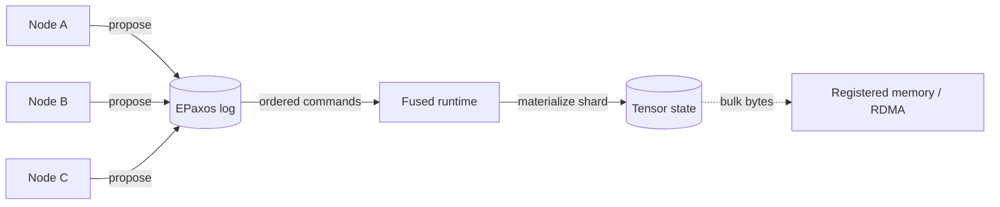

<p align="center">
  
</p>

<h1 align="center">Plait</h1>

<p align="center">
  <strong>A rankless, consensus-fused tensor fabric.</strong>
</p>

<p align="center">
  Rust 2024 · EPaxos-style replication · no rank 0 · TP/PP/EP/DP/CP/SP · heterogeneous accelerators · async TCP control · registered-memory data plane
</p>

Plait is an experimental runtime in which **communication is the replicated log**.
Instead of building a collective around a fixed process group and a rank-zero
driver, every process proposes tensor work into a leaderless consensus log. The
same ordered commands that coordinate a collective also carry the fused
operator's state transition. There is no special node, no global barrier, and
no array position that has to mean "leader".

This repository is a from-scratch Rust rewrite. The previous C++/CMake
foundation has been removed; the workspace now contains the protocol, fused
runtime, TCP transport, registered-memory data plane, parallelism planner,
capability-aware device scheduling, and runnable TP/CP/SP DSA, EP MoE, DP
optimizer, and PP stage-handoff operators.

> **Status:** research prototype, not a production training system. Correctness
> and the end-to-end mechanism are exercised by tests; security, persistence,
> real RNIC binding, and production-scale performance are explicit remaining
> work.

## The core idea



A command such as "contribute a local partial to operator `op`" is replicated.
When the last declared contributor has executed, every replica combines the
partials locally. The result is materialized without a separate all-reduce
phase. Conflicting commands are ordered by EPaxos dependencies; independent
operators proceed concurrently.

The control plane is an Asio-style Tokio actor: a single connection manager owns
the outbound socket table, callers communicate through bounded channels, and the
node loop is a `tokio::select!` over inbound frames, timers, and cancellation.
There is no application-level mutex or blocking receive on the control path.

The important properties are:

- **Identity, not rank.** `NodeId` is a stable 128-bit identity. It is never an
  array index and never changes when membership changes.
- **Leaderless steady state.** Any voter may propose. Any voter may recover a
  stalled instance by raising a ballot.
- **Membership is replicated state.** A join is a staged learner plus a
  unanimous promotion; a leave is a staged removal plus a unanimous commit.
  There is no bootstrap controller with permanent authority.
- **Communication is computation.** A contribution moves inside the replicated
  command and is consumed by the same state-machine transition on every
  replica. There is no separate "communicate then compute" collective.
- **Bulk data stays out of the log.** Small indices and partials travel inline;
  large tensors live in registered regions and move through one-sided
  descriptor operations.
- **Compute is a first-class access mode.** A compute task reserves a device and
  reads/writes its tensors; two kernels on one device conflict, while kernels on
  different devices can execute concurrently.
- **Devices are replicated capability data.** NVIDIA, AMD, Huawei, PPU, and CPU
  profiles are advertised as `DeviceProfile` commands; a scheduler chooses an
  eligible device from memory, dtype, architecture, load, and stable identity.

EPaxos is used here as a **design point**, not a claim of a byte-for-byte paper
implementation. The implementation includes fast-path dependency agreement,
Paxos slow-path acceptance, dependency-cycle execution, ballot-based recovery,
and snapshot catch-up. The deliberate deviations are documented under
[Guarantees and limits](#guarantees-and-limits).

## Parallelism alignment

Every parallelism axis is represented as a **participant group plus conflict
keys**, not as a collective that every process must enter. The planner lives in
`crates/plait-parallel/src/plan.rs`; the table is the contract between the
planner and the consensus/runtime layer.

| Axis | Work that is sharded | Plait mechanism | Conflict domain | Transfer |
| --- | --- | --- | --- | --- |
| **TP** tensor parallel | Attention heads / projection columns | Fused partial-sum output projection; per-head gathers | `tp:<cp>:output`, `seq:<tp>:<head>:*` | Registered for Q/K/V, inline for indices |
| **PP** pipeline parallel | Layers into stages | `Stage` command reads predecessor activation, writes successor; wavefront scheduler overlaps microbatches | `pp:<stage>:<microbatch>` | Registered descriptor |
| **EP** expert parallel | Tokens across experts | Sparse dispatch; per-expert compute; token combine as fused sum | `ep:<expert>:dispatch|combine` | Registered dispatch, inline combine |
| **DP** data parallel | Replicated model replicas | Per-parameter-shard gradient accumulation and optimizer step | `dp:<step>:gradient:<shard>` | Registered |
| **CP** context parallel | Sequence into KV shards | Local top-k candidates → global top-k; online-softmax partials | `ctx:<tp>:<head>:<query>:*` | Inline scores/partials; RDMA for Q |
| **SP** sequence parallel | Sequence shards within TP | Sequence gather for Q/Q-index; aliases the CP physical group in the reference runner | `seq:<tp>:<head>:*` | Inline index, registered activation |

The planner emits concrete fused operations with contributor sets and op ids:

- `FusedSum` replaces all-reduce / reduce-scatter for DP, TP output, and EP
  combine.
- `Gather` replaces all-gather for sequence/Q-index data.
- `TopK { k }` merges local sparse-attention candidate lists; no full score
  matrix needs to be all-gathered.
- `OnlineSoftmax` combines context-parallel partial softmax states
  `(max, sum, accumulator)` without a second global reduction.
- `PipelineHandoff` and `Dispatch` are registered-memory transfers coordinated
  by a small command; the bytes never enter the log.

`cargo test -p plait-parallel` checks that all six axes have an EPaxos mapping,
that participant groups match the topology, and that the EP/DP/PP reference
runners match single-node execution.

## Distributed DSA

`plait-parallel` contains a runnable **DeepSeek-style sparse attention (DSA)**
reference layer:

1. Q-index vectors are gathered across the CP/SP group through a fused
   `Gather` command.
2. Q is pulled through the registered-memory data plane (the loopback backend
   in this repository) rather than placed in the log.
3. Each CP shard computes local indexer scores for every query and contributes
   its local top-k candidates. A fused `TopK` command merges them into the
   global sparse key set.
4. Each CP shard computes a partial softmax state over its local selected K/V
   and contributes `(max, sum, accumulator)`. A fused `OnlineSoftmax` command
   produces the exact attention output.
5. TP shards compute partial output projections; a fused `Sum` completes the
   projection.

The reference runner is checked against a single-node implementation for both
context-parallel and tensor-parallel topologies:

```text
$ cargo run -q -p plait-node -- dsa
plait dsa: context-parallel output matches reference (max error 1.110e-16, 110 instances)
plait dsa: tensor-parallel output matches reference (max error 1.110e-16, 55 instances)
```

## Heterogeneous compute

`plait-device` discovers accelerators and advertises them as replicated data.
`plait-core` adds `Mode::Compute`, `Key::Device`, `RegisterDevice`, and
`Command::Compute`; `plait-fabric` records the resulting placement. The planner
exposes `ParallelOp::requirement()`, so a plan can be assigned across vendor
families:

```sh
cargo run -q -p plait-node -- devices
cargo run -q -p plait-node -- hetero
```

On the 8-GPU `pro5000` host this discovered 8× NVIDIA RTX PRO 5000 72GB
Blackwell + CPU and scheduled 32 planned operations:

```text
plait hetero: 9 devices, 32 compute tasks, placements {Cpu: 3, Nvidia: 29}
```

`hetero` now executes real work per placement: NVIDIA devices run CUTLASS
device-pointer/stream SGEMM with CPU-reference verification, and CPU devices run the CPU reference
GEMM. Device registration, eligibility, reservation, compute, and replicated
placement are all real. AMD/Huawei/PPU adapters are still the next layer;
they fail explicitly rather than silently using a CPU placeholder.

## 12-replica matrix collective

`just matrix` starts two TCP processes on one host with six replicas each
(12 voters, topology DP2×TP3×EP2), submits a matrix GEMM as twelve fused-sum
contributions, and checks the result against a CPU reference:

```text
plait matrix: 12 replicas DP2×TP3×EP2, 8x8x6, 12 contributions, checksum 103
```

The same mode crosses hosts. A tested layout puts six replicas on the local
`11.166.42.141` host and six on `pro5000`; SSH local forwarding exposes the
remote ports to the driver:

```sh
ssh -N -L 127.0.0.1:8201:127.0.0.1:8201 ... pro5000
plait-node matrix --manifest cross.manifest --start 0 --count 6 --driver
```

The client binds its reply listener to a reachable host address, not
`127.0.0.1`, so remote replicas can return Ack/QueryReply. The tested cross-host
result was the same checksum `103`.

## EP / DP / PP execution

`cargo run -q -p plait-node -- parallel` runs all three remaining axes through
the real consensus and fused runtime:

```text
plait moe: EP output matches reference (max error 0.000e0, 4 instances)
plait dp: 3-replica optimizer matches reference (max error 1.388e-17, 24 instances)
plait pp: 3 stages / 3 microbatches match reference (max error 0.000e0, max in flight 3, 9 instances)
```

- **EP MoE**: routing is replicated, expert compute is sharded, and each expert
  contributes a token-major delta. A fused `Sum` combines experts; top-2 routing
  is covered by a test.
- **DP**: gradients are split into parameter shards, each shard is a fused sum
  over DP replicas, and zeros in non-owned shards are avoided; the optimizer
  matches a single global-gradient run.
- **PP**: every stage emits a `Stage { input, output }` command. The EPaxos
  dependency on the input tensor orders stages; a wavefront scheduler keeps
  multiple microbatches in flight (`max in flight 3` in the demo).

## Registered memory and RDMA

`plait-mem` provides the data-plane contract:

- page-aligned `AlignedBuffer` allocations;
- a size-class `BufferPool` that returns buffers on drop;
- `RegionDescriptor { node, region, addr, offset, len, rkey, kind }`, the only
  thing a consensus command needs to reference bulk data;
- `RdmaPlane` with one-sided `read`/`write`;
- `LoopbackRdma`, a validated in-process implementation used by tests and the
  DSA runner;
- `plait-rdma`, a real `libibverbs` Reliable Connection backend built on the
  community `rdma-io` crate (safe RAII wrappers around rdma-core) with one-sided
  `RDMA_WRITE`/`RDMA_READ` and completion polling.

`plait-net` uses length-prefixed framed TCP with reusable send/receive buffers
as the portable fallback. `plait-rdma` now compiles and links against real
`libibverbs`; it registers aligned buffers, exchanges RC endpoints, and posts
one-sided writes/reads. The development container has no `/dev/infiniband`, no
`rdma_rxe` module, and no `CAP_NET_ADMIN`, so the self-test reports a skip:

```text
$ cargo run -q -p plait-node -- rdma-selftest
plait rdma: skipped (no verbs device; configure Soft-RoCE or an RNIC)
```

On a host with a device (or a configured Soft-RoCE `rxe` link), the same command
passes two-QP loopback write/read; `docs/rdma.md` has the setup commands and the
container limitation.

## Quick start

Install `just` once, then the recipes clone CUTLASS on demand and run the
unified gate:

```sh
just test        # setup + workspace tests
just demo        # three async TCP nodes, fused sum
just dsa         # TP/CP DSA vs single-node reference
just parallel    # EP MoE, DP optimizer, PP stages
just devices     # discovered NVIDIA/AMD/Huawei/PPU/CPU
just hetero      # capability-aware compute placement + CUTLASS GEMM
just matrix      # two-process, 12-replica TCP matrix collective
just gpu         # real CUDA AXPY + CUTLASS device-pointer SGEMM
just rdma        # real ibverbs or a clear skip
just ci          # fmt + lint + tests + demos
```

`just setup` clones the official NVIDIA CUTLASS repository into
`target/cutlass` (default `v4.8.1`) if it is missing. The GPU build script
detects the local compute capability: Ampere uses the CUDA 12.9 compiler when
available (the 3090 driver predates 13.2), Blackwell uses CUDA 13.2. No CUTLASS
checkout is committed to the repository.

Run a cluster process:

```sh
# Generate stable identities once, keep them in your deployment config.
cargo run -q -p plait-node -- id

# Every bootstrap node receives the same peer manifest.
cargo run -p plait-node -- run \
  --id <hex> --listen 127.0.0.1:7001 \
  --peer <hex-a>@127.0.0.1:7001 \
  --peer <hex-b>@127.0.0.1:7002 \
  --peer <hex-c>@127.0.0.1:7003
```

A new process joins through any member; no rank-zero address is needed:

```sh
cargo run -p plait-node -- run \
  --id <new-hex> --listen 127.0.0.1:7004 \
  --join <hex-b>@127.0.0.1:7002
```

The joining node receives a snapshot, replays the executed prefix, acknowledges
the unanimous promotion, and then proposes like every other voter.

## Workspace

| Crate | Responsibility |
| --- | --- |
| `plait-core` | identities, tensors/placement, commands, conflict keys, membership/quorums |
| `plait-consensus` | leaderless EPaxos instances, ballots, recovery, SCC execution, snapshots |
| `plait-fabric` | fused runtime (`Sum`, `Max`, `Gather`, `TopK`, `OnlineSoftmax`) and events |
| `plait-mem` | aligned buffers, pooling, registered regions, RDMA contract, loopback plane |
| `plait-rdma` | real `libibverbs` RC QP, one-sided read/write, completion polling |
| `plait-net` | framed TCP transport and the wire protocol |
| `plait-parallel` | TP/PP/EP/DP/CP/SP planner; DSA, MoE, DP, and PP reference runners |
| `plait-device` | vendor discovery, `DeviceProfile` capability model, deterministic scheduler |
| `plait-gpu` | real CUDA AXPY and CUTLASS SGEMM execution |
| `plait-collective` | peer-memory GPU collectives; ring/recursive/tree all-reduce, broadcast, reduce, all-gather, reduce-scatter, all-to-all |
| `plait-node` | real cluster process, join/snapshot flow, client, demos |

See the design of record in [docs/design/plait.md](docs/design/plait.md) with
its [requirements](docs/design/plait-requirements.md) and
[rendered architecture](docs/design/plait-architecture.html). Protocol details
are in [docs/architecture.md](docs/architecture.md), axis mapping in
[docs/parallelism.md](docs/parallelism.md), and the verbs backend in
[docs/rdma.md](docs/rdma.md). Remote validation is recorded in
[docs/validation/pro5000.md](docs/validation/pro5000.md); the NCCL equivalence
check is in [docs/validation/nccl.md](docs/validation/nccl.md); peer-memory
collectives and remaining gaps are in
[docs/validation/collectives.md](docs/validation/collectives.md), and the gated
parity plan is in [docs/goals/nccl-parity.md](docs/goals/nccl-parity.md); the
formal EPaxos workstream is in [docs/goals/epaxos-formal.md](docs/goals/epaxos-formal.md).

## Guarantees and limits

What is implemented and tested:

- fast-path agreement and slow-path acceptance for conflicting proposals;
- concurrent conflicting proposals from every node converging to the same state;
- recovery by any replica after the original proposer stops;
- dependency cycles executed through an online SCC condensation with a ready
  frontier, data/device/config/control edge classes, and parallel ready-SCC
  batches;
- membership add/remove with snapshots, staged learners, and unanimous
  promotion/removal;
- three-node real-TCP submission, fusion, and query;
- dynamic join over TCP, followed by a proposal from the new voter;
- CP and TP distributed DSA matching the single-node reference within `1e-16`;
- EP MoE (top-1 and top-2), DP optimizer steps, and PP stage handoffs matching
  their single-node references;
- real CUDA AXPY on 4× local RTX 3090 and 8× remote RTX PRO 5000 Blackwell, plus
  CUTLASS 4.8.1 SGEMM verified against a CPU reference on both;
- heterogeneous device profiles, compute-mode conflict keys, and a scheduler
  exercised across CPU/NVIDIA/AMD/Huawei/PPU profiles; 8 NVIDIA GPUs discovered
  and 32 compute placements replicated on `pro5000`;
- a compiling/linking real `libibverbs` backend with a two-QP self-test that
  runs when a device is present;
- a 12-contribution matrix checksum matching NVIDIA NCCL all-reduce at 8x8x6
  and 64x64x64, using `nccl-tests`-style warmup, timing, and bus bandwidth;
- real CUDA peer-memory collectives across all visible GPUs, with correctness
  tests for ring/recursive/reduce-broadcast all-reduce, broadcast, reduce,
  all-gather, reduce-scatter, and all-to-all;
- cross-process CUDA IPC peer memory and a two-process allreduce with no host
  staging after setup (`just ipc`), plus VMM export/import;
- pooled/aligned memory, registered descriptors, and one-sided loopback
  transfers bounds-checked;
- an explicit GPUDirect/VMM registration probe (`just gpu-rdma`) that skips when
  no verbs device is present.

Deliberate limits of this prototype:

- **No authentication or encryption.** The transport trusts the network. A
  production deployment must authenticate `NodeId` and authorize membership.
- **The ordinary containers do not expose RDMA.** The backend is real and
  compiles/links. On `pro5000`, a privileged helper container with host
  `/sys`, `/dev`, `/lib/modules`, and the `rdma_rxe` module ran a real Soft-RoCE
  two-QP `RDMA_WRITE` + `RDMA_READ` self-test successfully; the normal `pro5000`
  container still reports a clear skip because it has no `/dev/infiniband` and no
  `CAP_NET_ADMIN`/`CAP_SYS_MODULE`. See
  [docs/validation/pro5000.md](docs/validation/pro5000.md).
- **Only NVIDIA has a kernel adapter.** CUDA AXPY and CUTLASS SGEMM are real,
  and `hetero` uses CUTLASS for every NVIDIA placement. Device discovery,
  capability matching, and scheduling for AMD/Huawei/PPU exist, but their kernel
  adapters are next; unsupported architectures fail explicitly.
- **No durable state.** Node restart with the same identity is not handled;
  instances and counters live in memory. A voter that misses a membership
  change while partitioned must be restarted/rejoined; automatic snapshot
  catch-up for an existing stale voter is future work.
- **Membership is conservative.** Staging and committing a membership change
  require every relevant voter. Steady-state consensus still tolerates
  `floor((N-1)/2)` failures, but a membership change stalls if any voter is
  down. A joint-consensus configuration for online reconfiguration is future
  work.
- **Small payloads are inline.** The DSA reference uses descriptors for bulk Q
  and inline candidates/partials. The generic `Contribute` command still has an
  inline `Vec<f64>` variant; a fully descriptor-based tensor command is the next
  data-plane step. `plait-rdma` exposes descriptor-aware post methods, but the
  reference runners use loopback memory by default.
- **One replication group.** Every command is replicated by the configured
  voters. Per-domain consensus groups (for very large TP/EP deployments) are a
  planner/runtime extension, not yet implemented.
- **No persistence or checkpointing**, no backpressure, no production
  scheduler, and no Torch-compatible frontend.

## Roadmap

- [x] Rust workspace and removal of the C++ foundation
- [x] Identity-based membership and leaderless proposal/recovery
- [x] Fused `Sum`/`Max`/`Gather`/`TopK`/`OnlineSoftmax` runtime
- [x] Real-TCP cluster, snapshot join, and new-voter proposal
- [x] TP/PP/EP/DP/CP/SP operation planner
- [x] EP MoE, DP optimizer, and PP stage-handoff execution
- [x] Context- and tensor-parallel DSA reference execution
- [x] Registered-memory descriptors, pooling, and loopback data plane
- [x] Real `ibverbs` backend and two-QP Soft-RoCE self-test on `pro5000`
- [x] Heterogeneous device profiles, compute access mode, and capability scheduler
- [ ] Vendor kernel adapters (CUDA, ROCm, CANN, PPU) and GPU memory descriptors
- [ ] GPUDirect RDMA and multi-host RDMA traffic validation
- [ ] Descriptor-only bulk contribution commands and completion queues
- [ ] Per-domain consensus groups and hierarchical membership
- [ ] Durable snapshots, identity persistence, and authenticated transport
- [ ] Larger-model DSA and attention benchmarks with RDMA traffic accounting

## Relationship to Ferrule

Ferrule can consume Plait rather than hide it. Ferrule decides what a model
should compute; Plait owns tensor identity, placement, consensus ordering,
fused communication, and the data plane. The boundary stays useful for
training, inference, simulation, and non-ML array workloads alike.

## License

MIT. See [LICENSE](LICENSE).