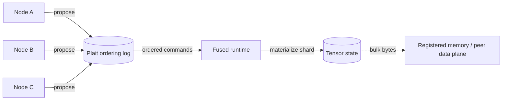

<p align="center">
  
</p>

<h1 align="center">Plait</h1>

<p align="center">
  <strong>A rankless, ordering-driven tensor fabric.</strong>
</p>

<p align="center">
  Rust 2024 · leaderless metadata · versioned groups · heterogeneous accelerators · GPU peer-memory collectives
</p>

Plait is a rankless runtime for heterogeneous collective communication and
distributed tensor execution. Its NCCL-compatible interface carries tensor
traffic. Its native control plane uses stable node identities, versioned
execution groups, and ordered resource grants so an affected group can be
replaced independently.

Plait schedules communication and tensor work within the device, layout, and
dependency constraints given by callers. The inference engine and its deployment
layer choose the model's parallel strategy and Prefill/Decode placement. They
also own KV storage, request migration, and token replay. The vLLM integration
exercises those engine capabilities against Plait's transport and metadata.

The research runtime includes the control plane, local metadata journals,
tensor reduction, GPU peer-memory collectives, and heterogeneous placement.
Cross-host GPUDirect RDMA, deployment authentication, and production-scale
validation remain open.

## Why this design

A conventional collective assumes a fixed communicator. Ranks are array
positions; membership changes require rebuilding the group and the communication
plan. Plait assumes churn. Nodes join and leave, GPUs differ in compute and link
class, and a single operator may have a different contributor set from the one
before it.



The log carries control metadata and small partials. Large tensors stay in
registered memory and move through peer pointers or one-sided descriptors.

## What is implemented

- **Leaderless ordering.** Any voter may propose. Fast-path dependency
  agreement, slow-path acceptance, ballot-based recovery, snapshots, and
  membership changes are implemented in `plait-consensus`.
- **Fused runtime.** `DeclareOp`, `Contribute`, and `Fuse` materialize tensor
  shards after all declared contributors have been applied. `Sum`, `Max`,
  `Gather`, `TopK`, and `OnlineSoftmax` are implemented.
- **SCC execution.** `ExecutionGraph` maintains an online SCC condensation.
  Independent components are ready in parallel; conflicting components stay
  together.
- **GPU peer-memory collectives.** Ring allreduce, broadcast, reduce,
  all-gather, reduce-scatter, and all-to-all use CUDA peer memory and
  device-resident flags in `plait-collective`. The device-ring allreduce is the
  default path.
- **Heterogeneous planning.** `HeterogeneousLayout` solves a max-min linear
  program over compute rate, effective bandwidth, and latency, then maps the
  result to contiguous row ranges.
- **Rejoin policy.** `RejoinCost` chooses between strict recovery, snapshot
  replay, and deterministic recomputation.
- **Formal models.** TLA+ covers ordering, epoch admission, and the path from
  quantized shard computation to asynchronous reduction and result delivery.

## Measured baseline

On one host with eight NVIDIA Blackwell GPUs, PCIe topology, no NVLink, Plait's
device-ring allreduce measured:

| Size | Plait | NCCL 2.30.4 |
|---:|---:|---:|
| 1 MiB | 11.0 GB/s | 4.82 GB/s |
| 16 MiB | 16.3 GB/s | 12.72 GB/s |
| 64 MiB | 15.7 GB/s | 13.60 GB/s |

The matrix path also matches NCCL's float allreduce checksum at `8x8x6` and
`64x64x64`. These numbers cover same-host allreduce only. They are not an
end-to-end training claim.

LL and LL128 protocol kernels exist but remain opt-in. On the PCIe test host,
their per-line synchronization is slower than the ring; PCIe defaults to ring
plus `Simple`.

## Heterogeneous 4+8 example

The planner models four NVIDIA Ampere ranks and eight NVIDIA Blackwell ranks:

```text
4 × NVIDIA Ampere     PCIe, compute 1.0, 25 Gbps
8 × NVIDIA Blackwell UB,   compute 4.0, 200 Gbps
```

Run:

```sh
cargo run -q -p plait-node -- hetero-plan
```

It reports fractional shares, integer row ranges, and the equal-split
comparison:

```text
local_share=0.111 remote_share=0.889
rows=64 local_rows=7 remote_rows=57
rows=64 equal_split_local=21 equal_split_remote=43
```

The eight faster ranks receive most of the work. Quorum membership remains one
vote per node; weights only change work assignment.

## Quick start

Install `just` and a Rust toolchain, then:

```sh
just test        # workspace tests
just demo        # three TCP nodes, fused sum
just dsa         # TP/CP sparse attention reference
just parallel    # EP MoE, DP optimizer, PP stage handoff
just devices     # discovered device profiles
just hetero      # capability-aware compute placement
just hetero-plan # 4+8 heterogeneous LP demo
cargo run -q -p plait-node -- hetero-plan --local-gflops 1394 --remote-gflops 4317
just matrix      # 12-replica matrix collective
just ipc         # two-process CUDA IPC allreduce
just tcp-twolevel-rust # Rust host-staged two-level TCP fallback
just gpu         # CUDA AXPY and CUTLASS SGEMM
just gpu-bench   # per-GPU CUTLASS SGEMM throughput
just rdma        # real ibverbs or an explicit skip
just ci          # fmt, lint, tests, demos
```

`just setup` clones CUTLASS into `target/cutlass` if needed. The CUDA build
selects the local architecture; no generated CUTLASS tree is committed.

## Commands and hardware

The GPU data plane requires peer-capable CUDA devices. Local NVIDIA Ampere machines
may refuse cross-GPU peer access; tests report the skip instead of hiding it.
The NVIDIA Blackwell host passes cross-GPU IPC.

The ibverbs backend compiles and links. The ordinary containers expose no
`/dev/infiniband`, no active verbs device, and no `CAP_NET_ADMIN`, so
`just gpu-rdma` and `just rdma` report explicit skips.

### TCP fallback

`crates/plait-collective/src/bin/tcp-twolevel.rs` is the Rust two-host
fallback. It reduces worker inputs into one host leader, exchanges the
aggregate over four TCP channels, publishes the result through shared memory,
and uses a ready barrier outside the timing loop. It is host-staged, not a
GPUDirect path.

Measured with 4 local NVIDIA Ampere ranks and 8 remote NVIDIA Blackwell ranks:

```text
1 MiB   0.081-0.083 GB/s  > NCCL 0.050
16 MiB  0.281-0.286 GB/s  > NCCL 0.273
errors=0
```

`crates/plait-nccl` provides a PyO3 NCCL-compatible communicator for vLLM.
The vLLM fork uses peer transport for TP collectives and PP activations when
`VLLM_USE_PLAIT=1` is set. A TP launch can read device grants and endpoints
from Plait's control plane by setting `VLLM_PLAIT_TP_GROUP_CONFIG`.
The engine's logical slot order is checked during the peer handshake.
[Join a committed TP group](docs/rankless-nccl.md#join-a-committed-tp-group-from-vllm)

One native TP4 group served Qwen3-0.6B in FP16 across CUDA, ROCm, CANN, and
HGGC workers with the vLLM multiprocess executor. All four workers reported
their grants ready, and the HTTP response's eight token IDs matched a single-device
baseline. [Four-vendor serving verification](docs/rankless-nccl.md#verify-four-vendor-tp4-over-http)

The Qwen3 V2 runner can overlap one prompt-logprob chunk's peer AllGather
with the next chunk's vocabulary projection. This path is opt-in and keeps
one chunk of lookahead. [Setup and validation](docs/rankless-nccl.md#overlap-vllm-prompt-scoring-with-peer-allgather)

The vLLM fork also supports sharded prompt scoring. It exchanges candidate
scores and normalizers, sums token ranks, and gathers full vocabulary logits
for rows that need the dense scorer.
[vLLM configuration](https://github.com/devillove084/vllm/blob/plait/v0.31-runtime/docs/serving/parallelism_scaling.md#plait-tensor-and-pipeline-parallelism)

A native TP4 group served dense AWQ with CUDA and CANN at W4A4 and ROCm
and PPU at W4A8. Three physical control peers agreed on the four device
grants. Six streamed completions returned the same eight token IDs.
[Integer activation setup](docs/rankless-nccl.md#run-dense-awq-with-integer-activations)

The deployment ingress resolves the active native epoch. The engine validates
the requested version before admission. Existing streams keep their upstream
connection.
[One HTTP endpoint for native groups](docs/rankless-nccl.md#route-native-groups-through-one-http-endpoint)

Native C and Rust callers can bind a communicator directly to an execution
group version and its device grants. Stable identities determine the default
slot order. Each peer validates the full manifest during the socket handshake.
[Native peer bootstrap](docs/rankless-nccl.md#join-by-device-identity)

The replicated group API reserves devices, collects endpoint records, and
publishes the canonical manifest. Each participant confirms the digest of
its connected communicator before the group can activate. Communicators joined
through the control plane close their sockets when a voter reports that their
grant has ended. A device grant is released after its owner confirms teardown.
[Replicated group metadata](docs/rankless-nccl.md#publish-a-manifest-through-the-control-plane)

A communicator can report a terminal device or transport failure against its
exact grant. One ordered operation revokes that version and activates an
eligible standby registered by the deployment layer. A standby affected by
the same known host loss is excluded.
[Communication group failover](docs/rankless-nccl.md#arm-a-standby-for-communication-group-failover)

The native planner matches placement to device capabilities, per-device
memory, host memory, and directional links measured by resident nodes.
It can reserve a replacement while the incumbent runs. The reservation
checks the group epoch, resource ledger, and probe sessions used to score
the plan. Callers can publish workload-specific compute rates on live
devices. A measured reservation also checks the rates of the chosen devices
and any incumbent devices used in the comparison.
[Heterogeneous group placement](docs/rankless-nccl.md#plan-across-heterogeneous-resources)

A node with `--group-replan` periodically evaluates caller-supplied
workload policies and reserves a successor after repeated matching
recommendations. Deployment starts the successor and decides when to activate it.
[Automatic group preparation](docs/rankless-nccl.md#prepare-replacements-automatically)

Callers can supply multiple compute and communication recipes for the same
group width. The planner scores them against device rates and link samples,
then commits the selected recipe with the version's device grants.
[Layout selection](docs/rankless-nccl.md#compare-layouts-of-the-same-width)

The vLLM fork can start engines from those grants. Its route publisher
checks both communicator and engine readiness, prepares the HTTP origin,
and then activates the new group. Deployment can assign a complete grant
group to either a tensor-parallel replica or a pipeline with one worker per stage.
[Automatic vLLM group deployment](docs/rankless-nccl.md#launch-and-activate-groups-from-the-vllm-fork)

### vLLM reference integration

The vLLM fork ships the aggregate and P/D ingress, stream recovery,
resident launcher, and serving benchmark as Python modules.
[Serving modules](https://github.com/devillove084/vllm/tree/plait/v0.31-runtime/vllm/entrypoints/serve/plait_serving)

The native P/D ingress keeps model routes in vLLM. A single ordered group
operation can switch several active epochs together. The ingress matches
both sides of a route against one ordered observation.
[Switch aggregate and P/D groups](docs/rankless-nccl.md#switch-aggregate-and-pd-using-native-groups)
The `plan_set` request finds disjoint placements for several successor
groups and charges their combined host memory. One ordered operation
reserves the entire set while the incumbent keeps serving.
[Prepare a group set](docs/rankless-nccl.md#prepare-several-groups-together)
The vLLM ingress can select among ready layouts using live arrival counters
and SLO measurements attached to exact group versions.
[Native layout policy](docs/rankless-nccl.md#select-a-ready-native-layout-from-live-demand)
The same policy can prepare a candidate set on demand. The ingress
discovers candidate origins from committed grants and switches after the
exact candidate versions have current SLO measurements.
[On-demand native layouts](docs/rankless-nccl.md#prepare-a-native-layout-on-demand)

Managed replacements reuse complete prompt KV blocks across TP sizes and PP
layouts with the vLLM fork's `PlaitKvConnector` and its optional
`vllm-plait-kv-store` binary.
The ingress restores emitted token checkpoints and reuses pages from the
prompt and generated prefix. The unified ingress supports greedy streams and
streams with an explicit seed on the standard V2 sampler.
[Planned stream handoff](docs/rankless-nccl.md#resume-a-stream-from-its-last-emitted-token)
[KV setup and scope](docs/rankless-nccl.md#reuse-prompt-kv-across-tp-layouts)

The control plane can activate a prepared replacement at final readiness
or promote it when the incumbent is revoked.
[Automatic rollout and standby](docs/rankless-nccl.md#commit-an-automatic-rollout-or-standby)
Resident execution nodes discover voters from seed addresses and start
their committed vLLM assignments using local engine profiles.
[Resident launches](docs/rankless-nccl.md#start-groups-from-resident-execution-nodes)
The planner can cap a hosted candidate's capacity using fresh TCP
samples, including traffic shared by multiple TP workers on one host.
[Measured host links](docs/rankless-nccl.md#replan-with-measured-host-links)

Hosted P/D pools accept `pipelines` alongside single-stage `sizes`. Each
pipeline names an engine profile, a TP width, and a list of stage budgets
with layer counts, per-worker memory, and SLO capacity. Resident nodes
register the same split as `pipeline_layers` on the engine profile. The
planner uses the launcher's API-first worker order and budgets stage TP,
forward activations, sampling feedback, and KV traffic on shared ports.
Active pipelines use the same budget during scaling and role changes.

The managed ingress accepts aggregate vLLM routes and split Prefill/Decode
routes under the same model alias. `prepare_hosted_serving` accepts both
route types in one revision. The voters publish after all referenced groups
are ready, and requests already admitted by a removed group can drain there.
Set `serving_modes` in a `pd_scaling` policy to compare aggregate, split,
and mixed targets against observed ingress load. Configure `aggregate_slots`
with the same pool format as the split slots. The policy scores shared NIC
and KV-store budgets at the ingress path shares, and charges startup and drain
against a configurable value per reclaimed device-second.
Enable `aggregate_stream_checkpoints` to launch aggregate replacements with
the same KV contract as split groups. The unified ingress can then hand off
an active completion across both serving shapes.
[Aggregate and split checkpoint setup](docs/rankless-nccl.md#share-checkpoints-between-aggregate-and-split-routes)
Set `checkpoint_traffic` on the P/D pool to include measured opt-in demand
and reserves for in-flight handoffs in the store and directional port budgets.
[Checkpoint traffic budgets](docs/rankless-nccl.md#budget-checkpoint-traffic-during-a-rollout)
The KV store admits optional reads and writes against a shared byte budget
and reports payload bytes and refusals.
[Store admission and metrics](docs/rankless-nccl.md#limit-optional-checkpoint-transfers)
Per-peer directional limits charge the shards of a checkpoint to their
actual TCP sources with one atomic page reservation.
[Directional checkpoint budgets](docs/rankless-nccl.md#limit-checkpoint-traffic-by-peer-and-direction)
Multiple stores can enforce disjoint shares of one peer budget and report
their installed plan for a deployment audit.
[Shared peer budgets](docs/rankless-nccl.md#share-a-peer-budget-across-kv-stores)
With durable control enabled, the stores can replace those shares after
draining old optional transfers while normal P/D KV continues.
[Online peer budget changes](docs/rankless-nccl.md#replace-peer-shares-online)

`begin_execution_drain` withdraws one device or a whole execution host from
new placements. The hosted planner can move affected groups at the incumbent
modeled capacity. Ready replacements publish before old workers drain.
`confirm_execution_drain` checks the original drain token, live grants, and
deferred claims in the ordered ledger. `resume_execution_target` clears that
scope. Other services on a host have independent maintenance lifecycles.

For the legacy rendezvous, `PLAIT_NCCL_SHM=1` enables the host-mapped local
path and `PLAIT_NCCL_KERNEL=1` enables the single-stream GPU allreduce path.
`plait_nccl.kernel_config(device, quantization)` returns a vLLM `KernelConfig`
using Humming on SM120 and Marlin/Cutlass on Ampere; the collective itself
stays bf16/fp16.
`plait_parallel::choose_codesign` picks the smallest fitting
`(quant format, TP group)`; eight SM120 cards therefore run 122B NVFP4 as four
TP2 replicas, while a 4B model runs as twelve TP1 replicas.
`plait_nccl.CapabilityRouter` routes local 9B-W4A16, remote 35B-FP8, and remote 122B-NVFP4 tiers.
The 122B tier requires native vLLM multiprocessing TP2; external-launcher TP
produced degenerate Qwen3.5 output even in BF16. FP8 communication is opt-in
(`plait_nccl.comm_quant.all_reduce_fp8`) and its accuracy/bandwidth gate
defaults off; it is only for cross-host TP.

Native TP startup (Qwen3.5 must not use `external_launcher`):

```bash
# four NVIDIA Ampere devices, one W4A16 TP1 replica per device
python -m vllm.entrypoints.serve.plait_serving.launcher \
  --model /models/local-w4a16 --replicas 4 --tp 1 --port-base 8000
# eight NVIDIA Blackwell devices, 122B-NVFP4, four independent native TP2 replicas
python -m vllm.entrypoints.serve.plait_serving.launcher \
  --model /models/remote-nvfp4 --replicas 4 --tp 2 --port-base 8100 --max-model-len 1024
```

Run it with:

```bash
just tcp-twolevel-rust
```

## Formal verification

An admitted operation carries an epoch and a fixed set of shards. A worker may
finish locally after revocation. Before publishing a shard, the worker waits
for a matching device event, copies the output, and checks its grant in the
control plane. Revocation can execute between that check and the local store.
Shards can arrive out of order and are folded in shard order. The caller can
release the result after the matching completion has executed in the control plane.

| TLA+ module | Properties checked with TLC |
| --- | --- |
| [Kernel primitives](specs/PlaitKernelPrimitives.tla) | Signed decoding, packed coordinate mapping, and exact integer dot products with accumulator bounds. |
| [W4A4](specs/PlaitW4A4.tla) and [W4A8 / W4A16](specs/PlaitW4Operators.tla) | INT32 zero-point correction and tail reads for W4A4, byte-wise subtraction for W4A8, and packed indexing and dequantization before rounding for W4A16. |
| [Caller-owned W4 stream](specs/PlaitW4CallerStream.tla) | Quantization precedes GEMM, queued work retains access to its scratch range, and a non-finite activation affects only its output row. TLC checked 7,263 distinct states. |
| [CANN caller-owned W4 stream](specs/PlaitW4CallerStreamCANN.tla) | FIFO execution with aligned Cube scratch and a scalar branch. Partial enqueue retains scratch until completion of the submitted stages is observed. TLC checked 7,420 distinct states. |
| [Asynchronous reduction](specs/PlaitAsyncReduction.tla) | W4A4 device completion, stale-event rejection, and deterministic folding. An independent operation completes even while a producer or pull in another operation stalls. |
| [Ordered publication](specs/PlaitOrderedPublication.tla) | Completion and revocation in the agreed command order, receipt identity on retry, and recovery from a replica's durable command prefix. |
| [Peer collectives](specs/PlaitPeerCollective.tla) | Independent link progress within scatter and gather, compatibility with paired rounds, and completion of a separate communicator after participant loss. |
| [Peer AllReduce pricing](specs/PlaitPeerAllReducePricing.tla) | Separate ingress and egress budgets, one RTT charge per exchange, exact shard traffic, and rejection of a quote with a missing direction. TLC checked 32 states across six representative cases. |
| [Peer AllReduce budget](specs/PlaitPeerAllReduceBudget.tla) | A new version verifies the egress budget and slot layout before joining. A failed candidate leaves the existing epoch usable. Default peers remain wire-compatible. TLC checked 4,472 distinct states. |
| [Native TP recipe budget](specs/PlaitNativeTpRecipeBudget.tla) | A recipe binds width and egress budget. Fresh link samples can change the next choice while the incumbent keeps its prior binding. Activation requires a matching, warmed replacement. TLC checked 46,608 distinct states. |
| [Hosted AllReduce profile](specs/PlaitHostedAllReduceProfile.tla) | Each candidate host advertises the committed profile. Startup resolves the exact profile and publication requires the peers to agree on its budget. TLC checked 352 distinct states. |
| [Hosted budget selection](specs/PlaitHostedBudgetSelection.tla) | A candidate requires fresh directed samples and support from every host. The incumbent is quoted with its committed profile as the link conditions change. TLC checked 2,484 distinct states. |
| [Rankless peer join](specs/PlaitRanklessPeerJoin.tla) | Socket handshakes bind the group version and grant view. Cancellation closes the participant's links. |
| [Logical slot layout](specs/PlaitRanklessLayout.tla) | A participant reports ready after connecting to all members with a common slot layout. |
| [Peer revocation](specs/PlaitPeerRevocation.tla) | Observing that an exact grant has ended closes that communicator and wakes a pending call. A draining group can keep its links. |
| [Peer failover](specs/PlaitPeerFailover.tla) | Exact-grant failure reports, readiness and host-loss eligibility for standby activation, one active version, and grant retention until release. |
| [Shared-host fault isolation](specs/PlaitSharedHostFault.tla) | A device fault revokes its group version. A separate group on the same host keeps its communicator and grants. The model also checks standby activation, asynchronous cancellation, and per-device release after stop. TLC checked 36,895 states. |
| [Peer collective requests](specs/PlaitPeerRequests.tla) | Blocking and ticketed operations share the wire order. A dropped ticket keeps its sequence, and a cancelled communicator denies delivery of a buffered result. TLC checked 695,556 states. |
| [Peer staging budgets](specs/PlaitPeerStaging.tla) | Asynchronous inputs and results retain their local byte reservations through exchange, abandonment, and delivery. TLC checked 19,584 states. |
| [Two-worker scatter/gather pipeline](specs/PlaitPeerScatterGatherPipeline.tla) | TCP frame order and reduced-prefix visibility hold for two pipelined workers and for a mixed-version pair. TLC checked 582 and 360 states. |
| [Staging and host reservations](specs/PlaitPeerStagingGrants.tla) | Co-located communicators divide the pageable part of their epoch's host reservation across device grants. TLC checked 75 states. |
| [Sharded prompt scoring](https://github.com/devillove084/vllm/blob/plait/v0.31-runtime/tools/plait/serving/specs/PlaitShardedPromptScores.tla) | Exact-integer candidate coverage and rank sums across 2,187 score vectors. TLC checked 1,024 states for agreement on fallback rows and collective order. |
| [Prompt scoring plan](https://github.com/devillove084/vllm/blob/plait/v0.31-runtime/tools/plait/serving/specs/PlaitPromptPlan.tla) | Every TP slot selects the same scoring path before issuing a collective. Sharded scoring requires matching vocabulary geometry. Overlap requires group-wide opt-in, and dense overlap requires a submitter on every slot. TLC checked 1,321 distinct states. |
| [Native launch failure](https://github.com/devillove084/vllm/blob/plait/v0.31-runtime/tools/plait/serving/specs/PlaitNativeLaunchFailure.tla) | Launchers recheck the version under the local claim. A failed candidate preserves its incumbent, and each grant stays held until the worker has stopped or the executable has been rejected. The failed launch keeps its claim until the release receipt. TLC checked 101 distinct states. |
| [Failed launch recovery](https://github.com/devillove084/vllm/blob/plait/v0.31-runtime/tools/plait/serving/specs/PlaitFailedLaunchRecovery.tla) | The launcher records a rejected exec before reporting it. After a crash, it retries with the original operation IDs. A reused device keeps its successor grant, and the journal stays until every release receipt has arrived. TLC checked 71 distinct states. |
| [Native engine stop](https://github.com/devillove084/vllm/blob/plait/v0.31-runtime/tools/plait/serving/specs/PlaitNativeEngineStop.tla) | Only the revoked process group is stopped. Grants remain held until its descendants exit, and the launcher preserves release IDs across restart. TLC checked 34 distinct states. |
| [Engine ownership across launcher restart](https://github.com/devillove084/vllm/blob/plait/v0.31-runtime/tools/plait/serving/specs/PlaitEngineOwnerRecovery.tla) | The local engine parent retains the launch lock, records ownership before exec, accepts the current instance's stop request, and records exit before grant return. TLC checked 41 distinct states. |
| [Orphaned engine recovery](https://github.com/devillove084/vllm/blob/plait/v0.31-runtime/tools/plait/serving/specs/PlaitOrphanCgroupRecovery.tla) | Recovery stops the exact revoked cgroup subtree, preserves independent groups, and releases grants after recording that the subtree is empty. TLC checked 32 distinct states. |
| [Sharded prompt overlap](https://github.com/devillove084/vllm/blob/plait/v0.31-runtime/tools/plait/serving/specs/PlaitShardedPromptOverlap.tla) | Workers may mix blocking and asynchronous calls while preserving collective order and retaining at most two projections. TLC checked that unfinished requests can take another step across 362 two-worker and 22,742 four-worker states. |
| [Replicated group manifest](specs/PlaitGroupManifest.tla) | Activation follows complete endpoint and handshake evidence. Retrying an old release preserves any successor grant. |
| [Native group placement](specs/PlaitGroupPlacement.tla) | A planned reservation checks the version, incumbent, and resource availability against concurrent changes. |
| [Native probe sessions](specs/PlaitProbePlacement.tla) | A planned reservation checks both endpoint revisions if a probe restarts after measurement. |
| [Native compute rates](specs/PlaitComputeRatePlacement.tla) | A measured reservation checks the selected devices and the scored incumbent. A worker can publish a rate while its exact grant is open. |
| [Resident group replanning](specs/PlaitGroupReplan.tla) | A planner submits after consecutive matching recommendations. Competing planners can reserve only one successor for the observed epoch. |
| [Committed group recipes](specs/PlaitGroupRecipe.tla) | Reservation binds the recipe and grants together. A launch uses the recipe recorded for its grant epoch. |
| [Active group sets](specs/PlaitActiveGroupSet.tla) | An ordered switch checks every expected epoch and applies the complete change. Routing uses one observation and requires every group in a P/D path. Existing work keeps its draining grants. |
| [Group set preparation](specs/PlaitGroupPrepareSet.tla) | Two placements share a staging ledger on one host. A stale guard or failed reservation leaves both versions and the ledger unchanged. A retry returns the same receipt. TLC checked 50,128 distinct states. |
| [Failed candidate sets](specs/PlaitAbortFailedSet.tla) | An abort uses the exact preparation receipt and requires a failed member and a batch that has never activated. Each grant remains held until its owner releases it. TLC checked 223,616 distinct states. |
| [Native serving mode policy](https://github.com/devillove084/vllm/blob/plait/v0.31-runtime/tools/plait/serving/specs/PlaitServingModePolicy.tla) | A switch requires repeated windows, a viable target, fresh profiles before send, and a matching active set at commit. A retry returns the original receipt. |
| [On-demand serving preparation](https://github.com/devillove084/vllm/blob/plait/v0.31-runtime/tools/plait/serving/specs/PlaitServingProvision.tla) | Stable demand can prepare a complete candidate set. Launch follows a grant. Switch dispatch checks the exact measured versions and each endpoint before the runtime compares the active set. TLC checked 101,760 distinct states. |
| [Serving calibration](https://github.com/devillove084/vllm/blob/plait/v0.31-runtime/tools/plait/serving/specs/PlaitServingCalibration.tla) | The private benchmark pins a complete candidate and leaves production counters unchanged. Changes to the observed active set, bindings, or configuration invalidate a running job. An accepted measurement can become the next incumbent baseline. TLC checked 1,211,296 distinct states. |
| [Calibration restore](https://github.com/devillove084/vllm/blob/plait/v0.31-runtime/tools/plait/serving/specs/PlaitServingProfileRestore.tla) | An atomic file update preserves the more recent measurement for the same identity. A restart revalidates the route, device grants, and lifetime before using the profile. TLC checked 425,728 distinct states. |
| [Native serving cutover](specs/PlaitNativeServingCutover.tla) | The deployment publishes a ready engine's origin before activation. An admitted stream keeps its version as ingress replicas observe the switch. |
| [Native serving retirement](specs/PlaitNativeServingRetire.tla) | Planned retirement closes admission, waits for the engine to drain, and releases each host's grants after its process group exits. |
| [Hosted rollout and failover](specs/PlaitHostLaunch.tla) | Full readiness before activation, ordered standby promotion on incumbent revocation, and exclusion of groups affected by the same host loss. |
| [Hosted assignment](specs/PlaitHostedAssignment.tla) | An observed assignment requires an ordered claim before launch. The local lock remains held through supervisor loss until the launcher exits. |
| [KFD device release](specs/PlaitKfdRelease.tla) | A complete report for the captured device checks its queues and VRAM. Activity on another device leaves release enabled. |
| [Hosted link evidence](specs/PlaitHostedLinkEvidence.tla) | Fresh directional samples match both probe sessions. Placement looks up the target role and TP width, then the shared width and configured default. TLC checked 682,534 states with [strict profiles](specs/PlaitHostedLinkEvidence.cfg) and 1,174,918 with the [fallback enabled](specs/PlaitHostedLinkEvidenceFallback.cfg). |
| [Hosted pool reservations](specs/PlaitHostedPool.tla) | A placement is checked against current inventory when prepared. Competing placements cannot reserve the same devices or API ports, including while a revoked group awaits retirement. |
| [Hosted P/D publication](specs/PlaitHostedPd.tla) | Both roles cut over in one publication after their participants report readiness. Candidate failure or a changed directory revision prevents a stale cutover. |
| [Hosted Decode width switch](specs/PlaitHostedPdDecodeSwitch.tla) | A ready Decode replaces its predecessor while Prefill keeps its grants. An admitted stream keeps its Decode epoch and retirement requires both old stop reports. TLC checked 3,929 distinct states. |
| [Hosted serving modes](specs/PlaitHostedServingModes.tla) | An aggregate, a split path, or both can be published in one revision after all target groups are ready. Removed groups drain admitted requests before retiring. |
| [Hosted checkpoint contract](specs/PlaitHostedCheckpointContract.tla) | A published route agrees with the KV contract of each participating group. A retained group version keeps its launch binding as the directory changes serving shapes. |
| [Hosted checkpoint budget](specs/PlaitHostedCheckpointBudget.tla) | A replacement preserves the incumbent rate after steady traffic and in-flight checkpoint reservations are charged to shared ports and storage. |
| [Checkpoint admission](https://github.com/devillove084/vllm/blob/plait/v0.31-runtime/tools/plait/kv-store/specs/PlaitCheckpointAdmission.tla) | Optional writes and reserved reads share a burst. Refill accounts for bytes already granted to unfinished transfers. |
| [Checkpoint peers](https://github.com/devillove084/vllm/blob/plait/v0.31-runtime/tools/plait/kv-store/specs/PlaitCheckpointPeers.tla) | A complete page reservation fits every peer and the store. Each peer claims only its own reserved bytes. |
| [Shared checkpoint peer budget](https://github.com/devillove084/vllm/blob/plait/v0.31-runtime/tools/plait/kv-store/specs/PlaitCheckpointPeerPlan.tla) | Independent store shares stay inside one directional budget over any sampled interval, including a store restart. |
| [Checkpoint budget replacement](https://github.com/devillove084/vllm/blob/plait/v0.31-runtime/tools/plait/kv-store/specs/PlaitCheckpointBudgetSwitch.tla) | Each generation installs one plan. Older generations stop admitting optional transfers and drain their grants before the next generation opens, including during conflicting proposals and restarts. |
| [Hosted mode selection](specs/PlaitHostedModeSelection.tla) | Mixed routes fit the combined port and KV-store budgets. A switch preserves the incumbent SLO rate and has positive benefit after startup and drain. |
| [Execution maintenance](specs/PlaitExecutionMaintenance.tla) | A new grant avoids a withdrawn target, a separate device keeps its group, and confirmation waits for both grants and deferred holds to release. |
| [Hosted P/D budgeting](specs/PlaitHostedPdBudget.tla) | Equal path shares consume the same Prefill and directional port budgets. The model checks combined TP and KV demand on shared ports. |
| [Hosted pipeline placement](specs/PlaitHostedPipelinePlacement.tla) | An API-first grant order assigns workers to the intended stage. A two-stage plan fits device and host memory, and the sum of TP, PP, and KV traffic fits the shared port. |
| [Hosted P/D scaling](specs/PlaitHostedPdScale.tla) | A proposed change uses repeated observations from the current ingress session and directory revision. Publication starts a new cooldown. |
| [Hosted P/D role transition](specs/PlaitHostedPdTransition.tla) | The replacement route becomes live before the old group retires. The target acquires the retired device only after release and becomes visible only after readiness. |
| [Hosted P/D reconfiguration](specs/PlaitHostedPdReconfigure.tla) | A bridge preserves the incumbent rate. The projected gain pays for the transition. Commit checks the directory and declared release capability. |
| [Hosted P/D recovery](specs/PlaitHostedPdRecovery.tla) | A spare can restore a failed slot without ingress traffic. Cutover preserves healthy epochs, checks readiness and directory revision, and requires proof to release old grants. Before publication, the model checks that a transition remains enabled. |
| [Hosted pipeline rollout](specs/PlaitHostedPipeline.tla) | Both pipeline lanes deliver activations for the admitted epoch. The next version waits for all workers, and the old version retires after its requests drain. |
| [Serving ingress](https://github.com/devillove084/vllm/blob/plait/v0.31-runtime/tools/plait/serving/specs/PlaitServingIngress.tla) | One admission per ordinary forwarded request, monotonic route refresh, version checks on native HTTP bindings, and output pinned to the admitted epoch. |
| [Completion replay and KV resume](https://github.com/devillove084/vllm/blob/plait/v0.31-runtime/tools/plait/serving/specs/PlaitCompletionReplay.tla) | Visible positions are preserved. Each KV resume sends the latest checkpoint and requires a matching acknowledgment and prefix before publishing a suffix. |
| [Completion prefix resume](https://github.com/devillove084/vllm/blob/plait/v0.31-runtime/tools/plait/serving/specs/PlaitCompletionPrefixResume.tla) | A V2 engine rebuilds context from the latest visible history. The ingress verifies its acknowledgment and both output prefixes before publishing a suffix. TLC checked 15,868 states. |
| [Planned stream handoff](https://github.com/devillove084/vllm/blob/plait/v0.31-runtime/tools/plait/serving/specs/PlaitPlannedStreamHandoff.tla) | A cut uses the last visible position and waits for a ready replacement. A seeded request requires a compatible sampler and a seed acknowledgment before the target publishes. |
| [KV publication](https://github.com/devillove084/vllm/blob/plait/v0.31-runtime/tools/plait/kv-store/specs/PlaitKvPublication.tla) | All heads must come from one write attempt before a page becomes readable. A consumer reads its requested head range, and a complete page stays immutable. |
| [Layered KV](https://github.com/devillove084/vllm/blob/plait/v0.31-runtime/tools/plait/kv-store/specs/PlaitLayeredKv.tla) | A page publishes after one write attempt covers every layer and head. A consumer can read it with a different stage partition or a whole-head request. |
| [Prefill to Decode handoff](https://github.com/devillove084/vllm/blob/plait/v0.31-runtime/tools/plait/serving/specs/PlaitKvHandoff.tla) | The receipt matches the request context. Decode emits output after loading the required pages, including when the shared store can reset between admission and load. |
| [P/D stream replay](https://github.com/devillove084/vllm/blob/plait/v0.31-runtime/tools/plait/serving/specs/PlaitPdStreamReplay.tla) | A failed Decode version is excluded. Each attempt releases its own handoff, and suffix output follows a checked prefix. The ingress can wait for a route within the original deadline. TLC checked 12,597 states. |

The ordered publication configuration explores 70,968 distinct states.
Run the suite with TLC 2.19 and `tlc` on your `PATH`.

```sh
./scripts/check-tla.sh
```

TLAPS discharged all 128 obligations. They establish W4A4 zero-point
correction for any finite group, packed-read bounds under the load guards, and
the matching-event and copy requirements for device publication.
[Proof module](specs/PlaitContractsProof.tla)

Run the proofs with `tlapm` on your `PATH`. The run uses the 1.6.0 pre-release
at commit `e4d66f4`. [TLAPS release](https://github.com/tlaplus/tlapm/releases/tag/1.6.0-pre)

```sh
(
  cache=$(mktemp -d)
  trap 'rm -rf "$cache"' EXIT
  tlapm --strict --threads 2 --cache-dir "$cache" specs/PlaitContractsProof.tla
)
```

The device model assumes stream ordering and output visibility after a
successful wait and copy. The ordered publication model assumes a common
order for commands that affect the same group. Each finite configuration
defines the inputs, faults, and fairness explored by TLC.

## Repository layout

| Crate | Responsibility |
| --- | --- |
| `plait-core` | identities, tensors, commands, conflict keys, membership, quorum policy |
| `plait-consensus` | leaderless ordering, ballots, recovery, SCC execution, snapshots |
| `plait-fabric` | fused runtime and replicated state transitions |
| `plait-collective` | CUDA peer-memory collectives, IPC/VMM, topology, protocols |
| `plait-parallel` | TP/PP/EP/DP/CP/SP planning, DSA/MoE/DP/PP runners, heterogeneous LP, rejoin |
| `plait-mem` | aligned buffers, pooling, registered regions, RDMA contract |
| `plait-rdma` | real libibverbs RC QP, one-sided read/write, completion polling |
| `plait-net` | framed TCP control transport |
| `plait-device` | device discovery and capability scheduling |
| `plait-gpu` | CUDA AXPY and CUTLASS SGEMM execution |
| `plait-node` | cluster process, client, benchmarks, demos |
| `plait-nccl` | PyO3 NCCL-compatible communicator for PyTorch/vLLM |

Design documents:

- [docs/design/plait.md](docs/design/plait.md) — design of record
- [docs/design/plait-requirements.md](docs/design/plait-requirements.md) — requirements
- [docs/design/asymmetric.md](docs/design/asymmetric.md) — heterogeneous row scheduling
- [docs/architecture.md](docs/architecture.md) — protocol and data flow
- [docs/parallelism.md](docs/parallelism.md) — parallelism-axis mapping
- [docs/rdma.md](docs/rdma.md) — verbs backend and setup
- [docs/goals/tcp-parity.md](docs/goals/tcp-parity.md) — TCP/NCCL acceptance goal
- [docs/nccl-python.md](docs/nccl-python.md) — vLLM/Python NCCL compatibility backend
- [docs/rankless-nccl.md](docs/rankless-nccl.md) — rankless groups and vendor backends
- [specs/](specs/) — TLA+ models and TLC configurations

## Limitations

- No authentication or encryption. The transport trusts the network.
- The local replica journal recovers ordered control state. Device buffers
  and in-flight tensor transfers must be recreated after process loss.
- No verified cross-host GPU-buffer collective outside the host-staged `plait-nccl` TCP path.
- Native kernel availability depends on the backend, architecture, shape,
  and activation format. Check the adapter's advertised capability before
  choosing a placement.
- LL/LL128 remain opt-in and are slower on the tested PCIe host.
- Vendor instruction semantics, floating-point rounding, and refinement from
  the Rust runtime and device code to these specifications remain open.

## License

See [LICENSE](LICENSE).
