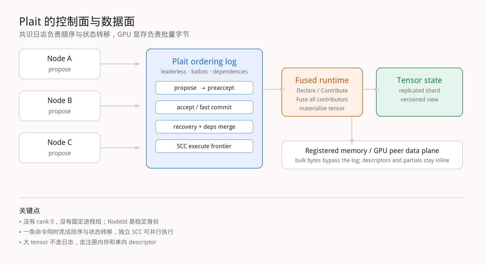
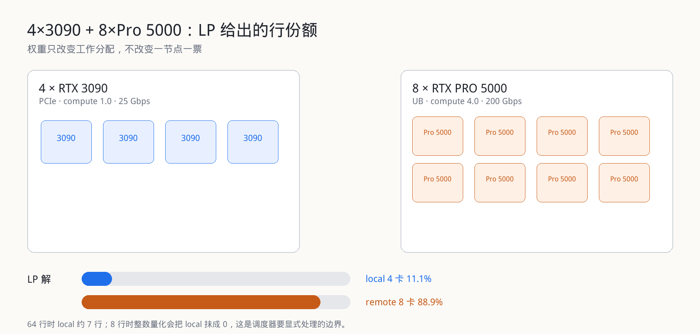

# 我把 AllReduce 塞进共识日志之后

跑完 `hetero-plan`，屏幕上最后一行是

```text
plait hetero-plan: rows=64 equal_split_local=21 equal_split_remote=43
```

上面一行是

```text
plait hetero-plan: rows=64 local_rows=7 remote_rows=57 predicted_makespan_ms=27.822
```

我盯着这两个 21 和 7 看了一会儿。4 张 3090 加 8 张 Pro 5000，按卡数平均分，3090 拿 21 行；按线性规划分，只拿 7 行。差得有点多。

这就是我想写下来的东西。我们换了一套分活和排序的办法，在 4+8 的机器上跑了一遍。

## 先看一组数

8 张 RTX PRO 5000，同一台机器，PCIe，没有 NVLink。Plait 的 device ring allreduce 和 NCCL 2.30.4 跑同一批尺寸。

| 消息大小 | Plait | NCCL |
|---:|---:|---:|
| 1 MiB | 11.0 GB/s | 4.82 GB/s |
| 16 MiB | 16.3 GB/s | 12.72 GB/s |
| 64 MiB | 15.7 GB/s | 13.60 GB/s |

这组数只覆盖单机 allreduce。训练会不会更快，我不知道。矩阵那套东西包含日志协议和 12 次提案，不能拿这些数字去推端到端。

但它至少说明，没有 rank 0 的 allreduce 不是只能做 demo。

## 为什么不用 communicator

NCCL 的做法我熟。先建 communicator，给每张卡一个 rank，再选 ring 或 tree。成员变了，communicator 和 rank 映射一起重建。

Plait 里没有这个圈。每个节点有一个稳定的 128 位 `NodeId`，不是数组下标，成员换了也不改号。节点把命令提到无主日志，日志给出全序。

一个 fused operator 长这样。

```rust
OpSpec {
    id,
    kind: FuseKind::Sum,
    contributors: {A, B, C},
    tensor: TensorKey,
    epoch,
}
```

节点先 `DeclareOp`，然后每个 contributor 提交 `Contribute`。最后一个提交执行完，所有副本在本地把 partial 合起来，得到同一份 tensor shard。

这里没有单独的 allreduce 阶段。排序、提交、求和是同一串状态转移。

我第一次把 `Contribute` 放进日志的时候，最担心的是日志被 tensor 撑爆。后来边界定在 partial 和 descriptor 上，大 tensor 走注册内存和单向 descriptor，不进日志。这个担心才放下。



## 4+8 的排班

4 张 3090 和 8 张 Pro 5000 放一起，按卡数平均分很省事。问题是 3090 慢，链路也慢，平均分以后尾延迟落在它们身上。

Plait 现在让 `HeterogeneousLayout` 解一个 max-min 线性规划。

```text
minimize T
subject to  a_i * x_i + b_i <= T
            sum x_i = 1, x_i >= 0

a_i = 1 / compute_i + message_bytes / bandwidth_i
b_i = latency_i
```

约束只有一个耦合项，不需要外部 solver。对 `T` 做参数搜索，得到每个 rank 的分数份额，再量化成整数权重，交给 `AsymmetricLayout::row_ranges` 切成连续行。

4+8 的实际参数按硬件填。

```text
4 × RTX 3090     PCIe, compute 1.0, 25 Gbps
8 × RTX PRO 5000 UB,   compute 4.0, 200 Gbps
```

解出来是 `local_share=0.111`，`remote_share=0.889`。64 行时，4 张 3090 一共 7 行，8 张 Pro 5000 拿 57 行。8 行的时候 local 会被量化成 0，这是整数分配在行数少于 rank 数时的边界，不能直接当成调度结果。调度器应该保留分数份额。



权重只改工作分配。投票还是一节点一票。把 quorum 权重也改掉，安全性就变了。

## NCCL 赢在哪，输在哪

NCCL 的 ring 和 tree 很成熟。我们在这台 PCIe 机器上跑赢，不代表在所有拓扑上都赢。NVLink 机器、跨机 RDMA、不同 NCCL 版本，结果都可能反过来。

Plait 占便宜的地方在结构。NCCL 的 communicator 是固定 rank 组。Plait 的成员和顺序是日志状态。4+8 分片、TP/EP/DP 的 contributor 集合、节点重新加入，都可以是一条命令，不用重建 communicator。

代价也在这。日志要处理冲突、依赖和恢复，控制面比 communicator 重。大 tensor 必须绕开日志，否则共识层会被压垮。

矩阵校验我用 12 个逻辑 contributor 跑 `DP2×TP3×EP2`，8×8×6 和 64×64×64 的 checksum 是 103 和 197，和 NCCL 的 float allreduce 对得上。它证明 fused sum 的语义没跑偏，不证明吞吐。

## TLA 跑出来的结果

顺序和恢复是我最不放心的部分。性能再快，只要两个 replica 对同一个 instance 提交不同值，前面都白搭。

`specs/` 下有有限 TLA 模型，用 TLC 跑。

```text
PlaitExecutionGraphSmall   3 节点调度器
PlaitExecutionGraphFive    5 节点调度器
PlaitOrderingSmall         ballot / preaccept / accept / commit / recovery
PlaitOrderingLive          两 instance recovery liveness
PlaitOrderingTiny          单实例 liveness
PlaitUnified               容量 / 计算 / 融合 / 提交 / 执行
PlaitUnifiedTiny           统一模型 liveness
```

查的性质有 `Agreement`、`CommittedStable`、`CommittedDepsStable`、`CapacityBound`、`FusionSound`、`CommitAfterFusion`、`DependencyClosure`。

ordering safety 和 liveness 跑了 1,986,053 个状态，271,441 个不同状态，没有报错。统一设计跑了 738,227 个不同状态。模型里有异构容量、贡献完整性、融合前置条件、dependency 顺序和最终执行。

这些只是有限抽象。Rust 代码和 TLA 还没有逐步 refinement。后来我们把严格 recovery 改成按成本选路，重算、snapshot replay、recovery ballot 三者取最小。这个选择只对确定性 shard 成立，已提交的命令还是走共识。

## 参考过的东西

HeteCCL 把异构 GPU 集群的 collective 调度写成 MILP，用 DSL 描述硬件和传输约束，再合成 schedule。我的 4+8 线性规划比它小，但问题形状一样。

https://www.usenix.org/system/files/nsdi26-hei.pdf

ForestColl 讨论异构 network fabric 上的 throughput-optimal collective。它让我把 NVLink、PCIe、跨 NUMA 的 SYS 链路分开建模，不再把拓扑当成一层 ring。

https://www.usenix.org/system/files/nsdi26-zhao-liangyu.pdf

TCCL 专门做 PCIe GPU 集群的 collective 路径和路由优化。我们这台 8 卡机没有 NVLink，PCIe 瓶颈和它描述的很像。

https://dl.acm.org/doi/10.1145/3620666.3651362

AsymGroup 做异构硬件下 2D tensor parallelism 的非对称分组。HexiScale 走得更远，直接做非对称并行和非均匀分片。它们支撑了“快卡多拿行”的方向，也解释了为什么不能只按卡数平均分。

https://dtl.yonsei.ac.kr/docs/International_Journal/[2025][ACCESS]%20AsymGroup.pdf

https://arxiv.org/html/2409.01143v2

Blink 是早期把 collective 调度做成可组合算法的系统。NCCL 的 LL128 给了我另一条教训，128 字节 line 加 flag 在 NVLink 上合适，在 PCIe 上不一定。我们最后没有把 LL128 设成默认路径，PCIe 继续走 ring 加 Simple。

https://proceedings.mlsys.org/paper_files/paper/2020/file/cd3a9a55f7f3723133fa4a13628cdf03-Paper.pdf

华为 UB 的 multicast 工作也值得看。它把复制和归约往网络里推，和 Plait 把 partial 放进日志是两种不同的融合方向。

https://arxiv.org/pdf/2605.22428v1

## 还没做完

两机 GPU buffer collective 还缺真实 RNIC。容器里没有 `/dev/infiniband`，`gpu-rdma` 只能明确 skip。

LL128 在 PCIe 上仍然慢，代码保留为 opt-in，没有进默认路径。

TLA 还需要消息级模型和 Rust action trace 的逐步对拍。现在的结论是设计在这些有限状态里没撞墙，不是实现已经被证明。

Plait 还是研究原型。它现在最有价值的地方，是把 collective、异构调度和成员变化放进了同一套可排序状态。下一步要接的是 rejoin 的成本模型，以及 TLA action 和 Rust trace 的对拍。
